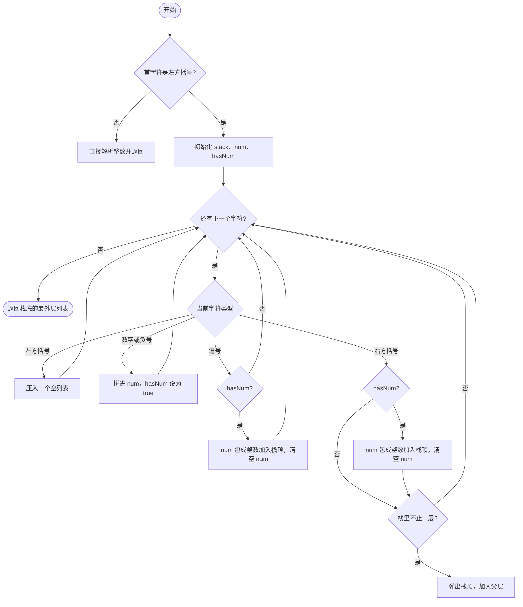

## 1. 题目描述

- [leetcode](https://leetcode.cn/problems/mini-parser/)

给定一个字符串 s 表示一个整数嵌套列表，实现一个解析它的语法分析器并返回解析的结果 `NestedInteger`。

列表中的每个元素只可能是整数或整数嵌套列表。

---

示例 1：

```txt
输入：s = "324",
输出：324
解释：你应该返回一个 NestedInteger 对象，其中只包含整数值 324。
```

---

示例 2：

```txt
输入：s = "[123,[456,[789]]]",
输出：[123,[456,[789]]]

解释：返回一个 NestedInteger 对象包含一个有两个元素的嵌套列表：
1. 一个 integer 包含值 123
2. 一个包含两个元素的嵌套列表：
    - 一个 integer 包含值 456
    - 一个包含一个元素的嵌套列表
        - 一个 integer 包含值 789
```

---

提示：

- `1 <= s.length <= 5 * 10^4`
- `s` 由数字、方括号 `"[]"`、负号 `'-'` 、逗号 `','` 组成
- 用例保证 `s` 是可解析的 `NestedInteger`
- 输入中的所有值的范围是 `[-10^6, 10^6]`

## 2. 题目解读

这道题其实就是自己实现一个“简化版 `JSON.parse`”：输入是一段长得像嵌套数组的文本，你要把它还原成题目给的 `NestedInteger` 对象结构，不能用现成的解析函数。

`NestedInteger` 可以理解成一个“盒子”，里面要么装一个整数，要么装一个列表，列表里的每一项又是一个 `NestedInteger`。题目只让你用它给好的几个方法搭这个结构：`new NestedInteger(x)` 造一个装整数的盒子，`new NestedInteger()` 造一个空列表盒子，`add(elem)` 往列表盒子里放东西。

对照示例来看：

- `"324"`：没有方括号，就是一个装着 324 的盒子，即 `new NestedInteger(324)`。
- `"[123,[456,[789]]]"`：最外层是个列表盒子，里面有两项，一项是装 123 的盒子，另一项又是个列表盒子，里面装着 456 和一个只含 789 的列表盒子。说白了就是把字符串还原成一棵树。

另外有几个容易漏的情况：

- 数字可能是负数，比如 `"-3"`；
- 列表可以为空，比如 `"[]"`；
- 列表里也可以套空列表，比如 `"[[],1]"`；

题目里的“输出”只是判题系统把你返回的对象再打印回字符串，所以看起来和输入一模一样，真正考的是中间这个对象结构有没有搭对。

---

为什么这道题的名称叫“迷你语法分析器”？

---

因为它做的就是编译器里“语法分析器”（parser）的活，只不过语法极小，所以叫“迷你”。英文原题名就是 Mini Parser。

语法分析器的工作，是按照一套语法规则读一段文本，再把它变成一个有层级的结构（通常是一棵树）。这道题的语法只有几条规则：一个元素要么是整数，要么是用方括号包起来、用逗号分隔的元素列表。你要做的正是按这套规则把字符串读成 `NestedInteger` 树。真正的语法分析器（比如 `JSON.parse` 或编程语言的编译器）原理一样，只是规则多得多。

对应到笔记的 s.1 解法：栈的作用是记住“现在在第几层括号里”，这正是处理嵌套语法的经典做法。另一种常见写法是递归下降，每遇到 `[` 就递归解析一个列表，名字里的“语法分析”更多就是指这一类思路。

## 3. s.1 - 栈解析

::: code-group

```c [c]
/**
 * *********************************************************************
 * // This is the interface that allows for creating nested lists.
 * // You should not implement it, or speculate about its implementation
 * *********************************************************************
 *
 * // Initializes an empty nested list and return a reference to the nested integer.
 * struct NestedInteger *NestedIntegerInit();
 *
 * // Return true if this NestedInteger holds a single integer, rather than a nested list.
 * bool NestedIntegerIsInteger(struct NestedInteger *);
 *
 * // Return the single integer that this NestedInteger holds, if it holds a single integer
 * // The result is undefined if this NestedInteger holds a nested list
 * int NestedIntegerGetInteger(struct NestedInteger *);
 *
 * // Set this NestedInteger to hold a single integer.
 * void NestedIntegerSetInteger(struct NestedInteger *ni, int value);
 *
 * // Set this NestedInteger to hold a nested list and adds a nested integer elem to it.
 * void NestedIntegerAdd(struct NestedInteger *ni, struct NestedInteger *elem);
 *
 * // Return the nested list that this NestedInteger holds, if it holds a nested list
 * // The result is undefined if this NestedInteger holds a single integer
 * struct NestedInteger **NestedIntegerGetList(struct NestedInteger *);
 *
 * // Return the nested list's size that this NestedInteger holds, if it holds a nested list
 * // The result is undefined if this NestedInteger holds a single integer
 * int NestedIntegerGetListSize(struct NestedInteger *);
 * };
 */
struct NestedInteger* deserialize(char* s) {
    if (s[0] != '[') {
        struct NestedInteger* ni = NestedIntegerInit();
        NestedIntegerSetInteger(ni, atoi(s));
        return ni;
    }
    int len = strlen(s);
    struct NestedInteger** stack = malloc(sizeof(struct NestedInteger*) * len);
    int top = 0, num = 0, sign = 1;
    bool hasNum = false;
    for (int i = 0; i < len; i++) {
        char ch = s[i];
        if (ch == '[') {
            stack[top++] = NestedIntegerInit();
        } else if (ch == '-') {
            sign = -1;
        } else if (ch >= '0' && ch <= '9') {
            num = num * 10 + (ch - '0');
            hasNum = true;
        } else {
            if (hasNum) {
                struct NestedInteger* ni = NestedIntegerInit();
                NestedIntegerSetInteger(ni, sign * num);
                NestedIntegerAdd(stack[top - 1], ni);
                num = 0;
                sign = 1;
                hasNum = false;
            }
            if (ch == ']' && top > 1) {
                struct NestedInteger* cur = stack[--top];
                NestedIntegerAdd(stack[top - 1], cur);
            }
        }
    }
    struct NestedInteger* res = stack[0];
    free(stack);
    return res;
}
```

```js [js]
/**
 * // This is the interface that allows for creating nested lists.
 * // You should not implement it, or speculate about its implementation
 * function NestedInteger() {
 *
 *     Return true if this NestedInteger holds a single integer, rather than a nested list.
 *     @return {boolean}
 *     this.isInteger = function() {
 *         ...
 *     };
 *
 *     Return the single integer that this NestedInteger holds, if it holds a single integer
 *     Return null if this NestedInteger holds a nested list
 *     @return {integer}
 *     this.getInteger = function() {
 *         ...
 *     };
 *
 *     Set this NestedInteger to hold a single integer equal to value.
 *     @return {void}
 *     this.setInteger = function(value) {
 *         ...
 *     };
 *
 *     Set this NestedInteger to hold a nested list and adds a nested integer elem to it.
 *     @return {void}
 *     this.add = function(elem) {
 *         ...
 *     };
 *
 *     Return the nested list that this NestedInteger holds, if it holds a nested list
 *     Return null if this NestedInteger holds a single integer
 *     @return {NestedInteger[]}
 *     this.getList = function() {
 *         ...
 *     };
 * };
 */
/**
 * @param {string} s
 * @return {NestedInteger}
 */
var deserialize = function (s) {
  if (s[0] !== '[') return new NestedInteger(parseInt(s))
  const stack = []
  let num = '',
    hasNum = false
  for (const ch of s) {
    if (ch === '[') {
      stack.push(new NestedInteger())
    } else if (ch === ']') {
      if (hasNum) {
        stack[stack.length - 1].add(new NestedInteger(parseInt(num)))
        num = ''
        hasNum = false
      }
      if (stack.length > 1) {
        const top = stack.pop()
        stack[stack.length - 1].add(top)
      }
    } else if (ch === ',') {
      if (hasNum) {
        stack[stack.length - 1].add(new NestedInteger(parseInt(num)))
        num = ''
        hasNum = false
      }
    } else {
      num += ch
      hasNum = true
    }
  }
  return stack[0]
}
```

```py [py]
# """
# This is the interface that allows for creating nested lists.
# You should not implement it, or speculate about its implementation
# """
#class NestedInteger:
#    def __init__(self, value=None):
#        """
#        If value is not specified, initializes an empty list.
#        Otherwise initializes a single integer equal to value.
#        """
#
#    def isInteger(self):
#        """
#        @return True if this NestedInteger holds a single integer, rather than a nested list.
#        :rtype bool
#        """
#
#    def add(self, elem):
#        """
#        Set this NestedInteger to hold a nested list and adds a nested integer elem to it.
#        :rtype void
#        """
#
#    def setInteger(self, value):
#        """
#        Set this NestedInteger to hold a single integer equal to value.
#        :rtype void
#        """
#
#    def getInteger(self):
#        """
#        @return the single integer that this NestedInteger holds, if it holds a single integer
#        The result is undefined if this NestedInteger holds a nested list
#        :rtype int
#        """
#
#    def getList(self):
#        """
#        @return the nested list that this NestedInteger holds, if it holds a nested list
#        The result is undefined if this NestedInteger holds a single integer
#        :rtype List[NestedInteger]
#        """

class Solution:
    def deserialize(self, s: str) -> NestedInteger:
        if s[0] != '[':
            return NestedInteger(int(s))
        stack = []
        num, has_num = '', False
        for ch in s:
            if ch == '[':
                stack.append(NestedInteger())
            elif ch == ']':
                if has_num:
                    stack[-1].add(NestedInteger(int(num)))
                    num, has_num = '', False
                if len(stack) > 1:
                    top = stack.pop()
                    stack[-1].add(top)
            elif ch == ',':
                if has_num:
                    stack[-1].add(NestedInteger(int(num)))
                    num, has_num = '', False
            else:
                num += ch
                has_num = True
        return stack[0]
```

:::

- 时间复杂度：$O(n)$，其中 $n$ 是字符串长度
- 空间复杂度：$O(d)$，其中 $d$ 是嵌套深度

算法思路：

- 遇 `[` 压入新 `NestedInteger`，遇数字则累加
- 遇 `,` 或 `]` 时将累积的数字加入栈顶元素
- 遇 `]` 时弹栈并合并到父层

栈解析的这种实现方式，本质上就是逐字符检查的过程，题目描述中保证了输入的 `s` 是可解析的合法字符串，我们需要做的就是逐字符遍历，不同的字符类型走不同的处理分支进行处理。



