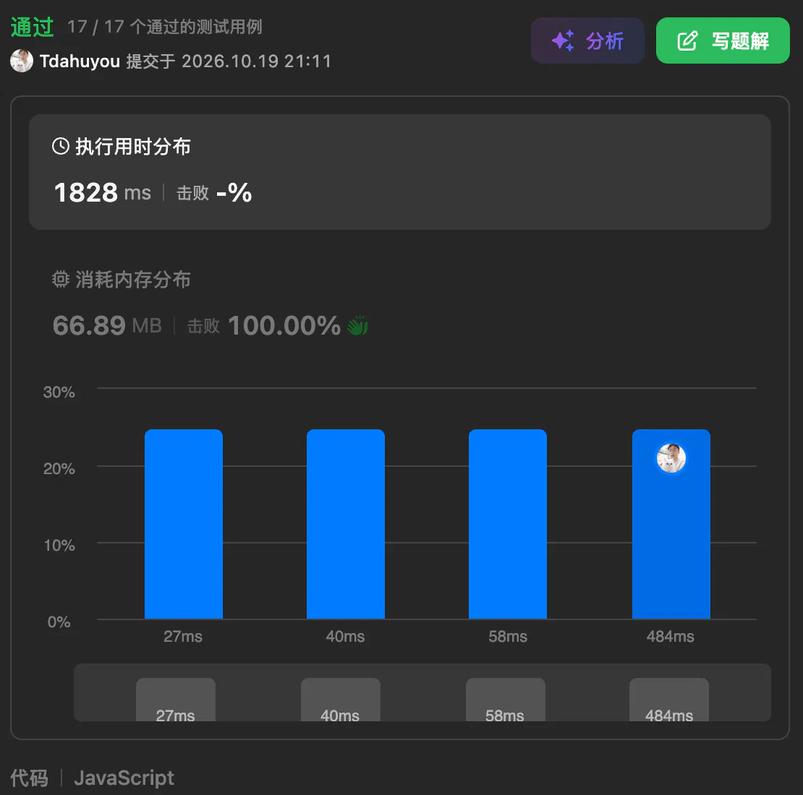
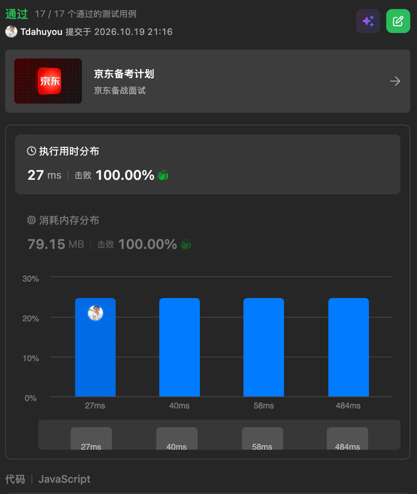

## 1. 题目描述

- [leetcode](https://leetcode.cn/problems/random-pick-index/)

给你一个可能含有重复元素的整数数组 `nums`，请你随机输出给定的目标数字 `target` 的索引。你可以假设给定的数字一定存在于数组中。

实现 `Solution` 类：

- `Solution(int[] nums)` 用数组 `nums` 初始化对象。
- `int pick(int target)` 从 `nums` 中选出一个满足 `nums[i] == target` 的随机索引 `i`。如果存在多个有效的索引，则每个索引的返回概率应当相等。

---

示例：

```txt
输入
["Solution", "pick", "pick", "pick"]
[[[1, 2, 3, 3, 3]], [3], [1], [3]]

输出
[null, 4, 0, 2]

解释
Solution solution = new Solution([1, 2, 3, 3, 3]);
solution.pick(3); // 随机返回索引 2, 3 或者 4 之一。每个索引的返回概率应该相等。
solution.pick(1); // 返回 0。因为只有 nums[0] 等于 1。
solution.pick(3); // 随机返回索引 2, 3 或者 4 之一。每个索引的返回概率应该相等。
```

---

提示：

- `1 <= nums.length <= 2 * 10^4`
- `-2^31 <= nums[i] <= 2^31 - 1`
- `target` 是 `nums` 中的一个整数
- 最多调用 `pick` 函数 `10^4` 次

## 2. 评价

这篇笔记中记录的两种题解可以对比着看，其中需要注意 s.1 中记录的解法，在提交的时候很可能会被判定为超时，不过思路是没问题的，相当于是用时间来换空间了。

## 3. s.1 - 蓄水池抽样

::: code-group

```c [c]
/**
 * 思路正确，但每次 pick 都要 O(n) 遍历
 * nums 长度 2e4、pick 调用 1e4 次，全相同时循环合计约 2e8 次，提交会超时
 * 可通过的实现见 s.2
 */
typedef struct {
    int* nums;
    int numsSize;
} Solution;

Solution* solutionCreate(int* nums, int numsSize) {
    Solution* obj = (Solution*)malloc(sizeof(Solution));
    obj->nums = (int*)malloc(sizeof(int) * numsSize);
    for (int i = 0; i < numsSize; i++) obj->nums[i] = nums[i];
    obj->numsSize = numsSize;
    return obj;
}

int solutionPick(Solution* obj, int target) {
    int res = 0, count = 0;
    for (int i = 0; i < obj->numsSize; i++) {
        if (obj->nums[i] == target) {
            count++;
            if (rand() % count == 0) res = i;
        }
    }
    return res;
}

void solutionFree(Solution* obj) {
    free(obj->nums);
    free(obj);
}

/**
 * Your Solution struct will be instantiated and called as such:
 * Solution* obj = solutionCreate(nums, numsSize);
 * int param_1 = solutionPick(obj, target);
 * solutionFree(obj);
*/
```

```js [js]
/**
 * @param {number[]} nums
 */
var Solution = function (nums) {
  this.nums = nums
}

/**
 * @param {number} target
 * @return {number}
 */
Solution.prototype.pick = function (target) {
  let res = 0,
    count = 0
  for (let i = 0; i < this.nums.length; i++) {
    if (this.nums[i] === target) {
      count++
      if (Math.random() < 1 / count) res = i
    }
  }
  return res
}

/** 
 * Your Solution object will be instantiated and called as such:
 * var obj = new Solution(nums)
 * var param_1 = obj.pick(target)
 */
```

```py [py]
# 思路正确，但每次 pick 都要 O(n) 遍历
# pick 最多调用 1e4 次、nums 长度可达 2e4，解释执行下循环开销大，提交会超时
# 可通过的实现见 s.2
class Solution:
    def __init__(self, nums: List[int]):
        self.nums = nums

    def pick(self, target: int) -> int:
        res, count = 0, 0
        for i, num in enumerate(self.nums):
            if num == target:
                count += 1
                if random.randrange(count) == 0:
                    res = i
        return res


# Your Solution object will be instantiated and called as such:
# obj = Solution(nums)
# param_1 = obj.pick(target)
```

:::

- 时间复杂度：初始化 $O(1)$、`pick` $O(n)$
- 空间复杂度：$O(1)$（不计输入数组）

算法思路：

- 遍历数组，第 $k$ 个等于 `target` 的元素以 $\frac{1}{k}$ 的概率替换答案
- 从而保证每个符合条件的索引被等概率返回

注意：其中部分题解（比如 C/Python）在提交时会提示超时，但是思路是没问题的。蓄水池采样算法能够更省空间，但是并不一定会更快，比如上述解法中，每次 `pick` 的代价要 $O(n)$ 扫一遍。

下面是 JS 版的提交结果，虽然通过了，不过这个时间感觉距离超时报错也不远了。空间的消耗表现还是很可观的，击败 100%。

 {w=555px}

## 4. s.2 - 哈希表

::: code-group

```c [c]
#define LOAD_FACTOR 4

typedef struct {
    int key;
    int cnt;   // 该值出现次数，0 表示空槽
    int start; // 该值的下标在 pos 中的起始位置
} Slot;

typedef struct {
    int cap; // 槽位数量，2 的幂
    Slot* slots;
    int* pos; // 按值分组存放原始下标
} Solution;

static int hash(int key, int cap) {
    return (int)(((unsigned)key * 2654435761u) & (cap - 1));
}

Solution* solutionCreate(int* nums, int numsSize) {
    // 蓄水池抽样每次 pick 都要 O(n) 遍历，nums 全相同时会超时
    // 改为预处理：值 -> 下标列表，pick 时随机取一个下标
    int cap = 1;
    while (cap < numsSize * LOAD_FACTOR) cap <<= 1;
    Solution* obj = (Solution*)malloc(sizeof(Solution));
    obj->cap = cap;
    obj->slots = (Slot*)calloc(cap, sizeof(Slot));
    obj->pos = (int*)malloc(sizeof(int) * numsSize);

    for (int i = 0; i < numsSize; i++) { // 第一遍：统计每个值的出现次数
        int h = hash(nums[i], cap);
        while (obj->slots[h].cnt && obj->slots[h].key != nums[i]) h = (h + 1) & (cap - 1);
        if (obj->slots[h].cnt == 0) obj->slots[h].key = nums[i];
        obj->slots[h].cnt++;
    }

    int off = 0;
    for (int i = 0; i < cap; i++) { // 累加出每个值的起始位置
        if (obj->slots[i].cnt) {
            obj->slots[i].start = off;
            off += obj->slots[i].cnt;
        }
    }

    for (int i = 0; i < numsSize; i++) { // 第二遍：按下标顺序填入 pos
        int h = hash(nums[i], cap);
        while (obj->slots[h].key != nums[i]) h = (h + 1) & (cap - 1);
        obj->pos[obj->slots[h].start++] = i;
    }

    for (int i = 0; i < cap; i++) // 复原 start
        if (obj->slots[i].cnt) obj->slots[i].start -= obj->slots[i].cnt;

    return obj;
}

int solutionPick(Solution* obj, int target) {
    int h = hash(target, obj->cap);
    while (obj->slots[h].cnt && obj->slots[h].key != target) h = (h + 1) & (obj->cap - 1);
    Slot* slot = &obj->slots[h];
    return obj->pos[slot->start + rand() % slot->cnt];
}

void solutionFree(Solution* obj) {
    free(obj->slots);
    free(obj->pos);
    free(obj);
}

/**
 * Your Solution struct will be instantiated and called as such:
 * Solution* obj = solutionCreate(nums, numsSize);
 * int param_1 = solutionPick(obj, target);
 * solutionFree(obj);
*/
```

```js [js]
/**
 * @param {number[]} nums
 */
var Solution = function (nums) {
  this.pos = new Map()
  for (let i = 0; i < nums.length; i++) {
    const list = this.pos.get(nums[i])
    if (list) list.push(i)
    else this.pos.set(nums[i], [i])
  }
}

/**
 * @param {number} target
 * @return {number}
 */
Solution.prototype.pick = function (target) {
  const list = this.pos.get(target)
  return list[Math.floor(Math.random() * list.length)]
}

/** 
 * Your Solution object will be instantiated and called as such:
 * var obj = new Solution(nums)
 * var param_1 = obj.pick(target)
 */
```

```py [py]
class Solution:
    def __init__(self, nums: List[int]):
        # 蓄水池抽样每次 pick 都要 O(n) 遍历，pick 最多 1e4 次，Python 下会超时
        # 改为预处理：值 -> 该值出现的全部下标，pick 时随机取一个下标
        self.pos = defaultdict(list)
        for i, num in enumerate(nums):
            self.pos[num].append(i)

    def pick(self, target: int) -> int:
        return random.choice(self.pos[target])


# Your Solution object will be instantiated and called as such:
# obj = Solution(nums)
# param_1 = obj.pick(target)
```

:::

- 时间复杂度：初始化 $O(n)$、`pick` $O(1)$
- 空间复杂度：$O(n)$

算法思路：

- 初始化时把「值 → 该值出现的全部下标」存入哈希表
- `pick` 时等概率随机取该值下标列表中的一个

下边儿同样是 JS 版本的提交结果，可以对比 s.1 来看时间和空间差异。

 {w=555px}
