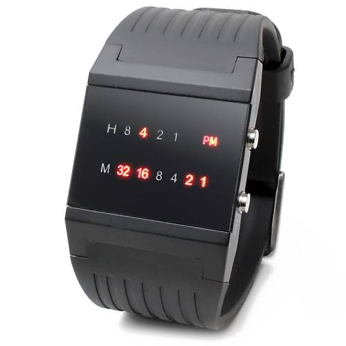

## 1. 题目描述

- [leetcode](https://leetcode.cn/problems/binary-watch)

二进制手表顶部有 4 个 LED 代表小时（0-11），底部的 6 个 LED 代表分钟（0-59）。每个 LED 代表一个 0 或 1，最低位在右侧。

- 例如，下面的二进制手表读取 `"4:51"`。

 {w=500px align=center}

给你一个整数 `turnedOn`，表示当前亮着的 LED 的数量，返回二进制手表可以表示的所有可能时间。你可以 **按任意顺序** 返回答案。

小时不会以零开头：

- 例如，`"01:00"` 是无效的时间，正确的写法应该是 `"1:00"`。

分钟必须由两位数组成，可能会以零开头：

- 例如，`"10:2"` 是无效的时间，正确的写法应该是 `"10:02"`。

---

示例 1：

```txt
输入：turnedOn = 1
输出：["0:01", "0:02", "0:04", "0:08", "0:16", "0:32", "1:00", "2:00", "4:00", "8:00"]
```

---

示例 2：

```txt
输入：turnedOn = 9
输出：[]
```

解释：因为合法时间最多点亮的灯不够 9 盏。

小时最多用到 `11 = 1011`，4 个灯里最多亮 3 个；分钟最多 `59 = 111011`，6 个灯里最多亮 5 个。两边加起来最多 `3 + 5 = 8`，所以 `turnedOn = 9` 不可能拼出合法时间，返回 `[]`。

---

提示：

- `0 <= turnedOn <= 10`

## 2. s.1 - 枚举 + 位计数

::: code-group

```c [c]
/**
 * Note: The returned array must be malloced, assume caller calls free().
 */
int bitCount(int n) {
    int count = 0;
    while (n) {
        count++;
        n &= n - 1;
    }
    return count;
}

char** readBinaryWatch(int turnedOn, int* returnSize) {
    char** res = (char**)malloc(sizeof(char*) * 720);
    *returnSize = 0;
    for (int h = 0; h <= 11; h++) {
        for (int m = 0; m <= 59; m++) {
            if (bitCount(h) + bitCount(m) == turnedOn) {
                res[*returnSize] = (char*)malloc(6);
                sprintf(res[*returnSize], "%d:%02d", h, m);
                (*returnSize)++;
            }
        }
    }
    return res;
}
```

```js [js]
/**
 * @param {number} turnedOn
 * @return {string[]}
 */
var readBinaryWatch = function (turnedOn) {
  const res = []
  for (let h = 0; h <= 11; h++) {
    for (let m = 0; m <= 59; m++) {
      if (bitCount(h) + bitCount(m) === turnedOn) {
        res.push(`${h}:${m < 10 ? '0' + m : m}`)
      }
    }
  }
  return res
}

function bitCount(n) {
  let count = 0
  while (n) {
    count++
    n &= n - 1 // 清除最低位的 1
  }
  return count
}
```

```py [py]
class Solution:
    def readBinaryWatch(self, turnedOn: int) -> list[str]:
        def bit_count(n: int) -> int:
            count = 0
            while n:
                count += 1
                n &= n - 1  # 清除最低位的 1
            return count

        res = []
        for h in range(12):
            for m in range(60):
                if bit_count(h) + bit_count(m) == turnedOn:
                    res.append(f"{h}:{m:02d}")
        return res
```

:::

- 时间复杂度：$O(1)$，合法时间固定为 $12 \times 60 = 720$ 种
- 空间复杂度：$O(1)$，不计返回数组

算法思路：

- 枚举所有合法时间：小时 $0 \sim 11$，分钟 $0 \sim 59$
- 用 `n &= n - 1` 统计二进制中 $1$ 的个数，即该时刻点亮的 LED 数
- 若小时与分钟的亮灯数之和等于 `turnedOn`，按格式加入答案（小时不补零，分钟两位）
