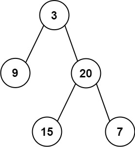

## 1. 题目描述

- [leetcode](https://leetcode.cn/problems/sum-of-left-leaves)

给定二叉树的根节点 `root`，返回所有左叶子之和。

---

示例 1：

 {w=189px}

```txt
输入: root = [3, 9, 20, null, null, 15, 7]
输出: 24
解释: 在这个二叉树中，有两个左叶子，分别是 9 和 15，所以返回 24
```

---

示例 2：

```txt
输入: root = [1]
输出: 0
```

---

提示：

- 节点数在 `[1, 1000]` 范围内
- `-1000 <= Node.val <= 1000`

## 2. s.1 - 递归

::: code-group

```c [c]
/**
 * Definition for a binary tree node.
 * struct TreeNode {
 *     int val;
 *     struct TreeNode *left;
 *     struct TreeNode *right;
 * };
 */
bool isLeaf(struct TreeNode* node) {
    return node && !node->left && !node->right;
}

int sumOfLeftLeaves(struct TreeNode* root) {
    if (!root) return 0;
    int sum = 0;
    if (isLeaf(root->left)) {
        sum += root->left->val;
    }
    sum += sumOfLeftLeaves(root->left);
    sum += sumOfLeftLeaves(root->right);
    return sum;
}
```

```js [js]
/**
 * Definition for a binary tree node.
 * function TreeNode(val, left, right) {
 *     this.val = (val===undefined ? 0 : val)
 *     this.left = (left===undefined ? null : left)
 *     this.right = (right===undefined ? null : right)
 * }
 */
/**
 * @param {TreeNode} root
 * @return {number}
 */
var sumOfLeftLeaves = function (root) {
  if (!root) return 0

  let sum = 0

  // 如果左子节点是叶子节点
  if (isLeaf(root.left)) {
    sum += root.left.val
  }

  // 递归处理左右子树
  sum += sumOfLeftLeaves(root.left)
  sum += sumOfLeftLeaves(root.right)

  return sum
}

// 判断是否为左叶子节点的函数
const isLeaf = (node) => {
  return node && !node.left && !node.right
}
```

```py [py]
# Definition for a binary tree node.
# class TreeNode:
#     def __init__(self, val=0, left=None, right=None):
#         self.val = val
#         self.left = left
#         self.right = right
class Solution:
    def sumOfLeftLeaves(self, root: TreeNode | None) -> int:
        def is_leaf(node: TreeNode | None) -> bool:
            return bool(node and not node.left and not node.right)

        if not root:
            return 0
        sum_ = 0
        if is_leaf(root.left):
            sum_ += root.left.val
        sum_ += self.sumOfLeftLeaves(root.left)
        sum_ += self.sumOfLeftLeaves(root.right)
        return sum_
```

:::

- 时间复杂度：$O(n)$，每个节点访问一次
- 空间复杂度：$O(h)$，递归栈深度为树高

算法思路：

- 左叶子：某节点的左孩子存在，且该左孩子没有左右子节点
- DFS 遍历每个节点；若当前节点的左孩子是叶子，累加其值
- 再分别递归左右子树，把两侧结果相加
