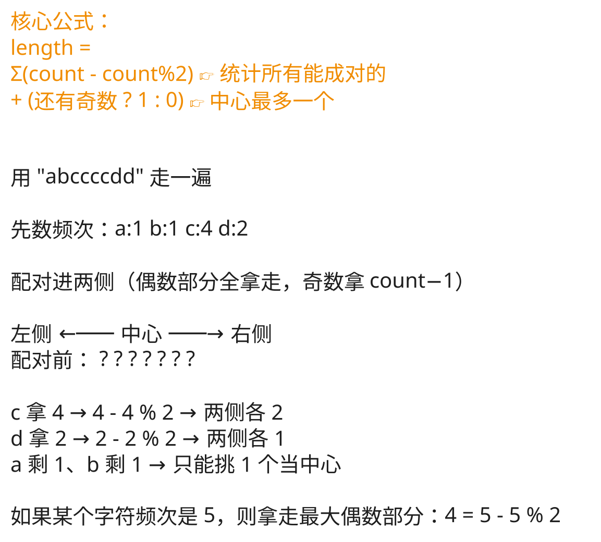

## 1. 题目描述

- [leetcode](https://leetcode.cn/problems/longest-palindrome/)

给定一个包含大写字母和小写字母的字符串 `s`，返回通过这些字母构造成的最长的回文串的长度。

> 回文串是向前和向后读都相同的字符串。

在构造过程中，请注意区分大小写。比如 `"Aa"` 不能当做一个回文字符串。

---

示例 1：

```txt
输入：s = "abccccdd"
输出：7
解释：我们可以构造的最长的回文串是"dccaccd", 它的长度是 7。
```

---

示例 2：

```txt
输入：s = "a"
输出：1
解释：可以构造的最长回文串是"a"，它的长度是 1。
```

---

提示：

- `1 <= s.length <= 2000`
- `s` 只由小写和/或大写英文字母组成

## 2. s.1 - 频次统计




::: code-group

```c [c]
int longestPalindrome(char* s) {
    int freq[128] = {0};
    for (int i = 0; s[i]; ++i) {
        freq[(unsigned char)s[i]]++;
    }

    int length = 0;
    for (int i = 0; i < 128; ++i) {
        length += freq[i] - (freq[i] % 2);
    }

    int n = (int)strlen(s);
    return length < n ? length + 1 : length;
}
```

```js [js]
/**
 * @param {string} s
 * @return {number}
 */
var longestPalindrome = function (s) {
  const freq = {}
  for (let char of s) {
    freq[char] = (freq[char] || 0) + 1
  }

  let length = 0
  for (let count of Object.values(freq)) {
    length += count - (count % 2) // 加入最大偶数部分
  }

  // 如果还能加一个中心字符（说明有奇数频次字符被截断了）
  return length < s.length ? length + 1 : length
}
```

```py [py]
class Solution:
    def longestPalindrome(self, s: str) -> int:
        freq: dict[str, int] = {}
        for ch in s:
            freq[ch] = freq.get(ch, 0) + 1

        length = 0
        for count in freq.values():
            length += count - (count % 2)

        return length + 1 if length < len(s) else length
```

:::

- 时间复杂度：$O(n)$，遍历字符串统计频次，再遍历频次数组
- 空间复杂度：$O(|\Sigma|)$，字母种类至多 52，可视作常数

算法思路：

- 回文两侧字符必须成对出现；中心最多还能再放 1 个奇数次字符
- 统计每个字符频次：偶数全部用上，奇数用 `count - 1`
- 若存在被截掉的奇数（`length < n`），最终再 `+1` 作为中心

