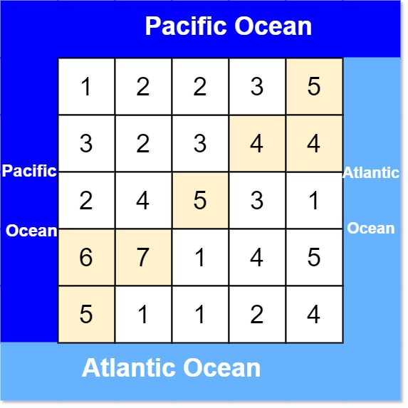

## 1. 题目描述

- [leetcode](https://leetcode.cn/problems/pacific-atlantic-water-flow/)

有一个 `m × n` 的矩形岛屿，与太平洋和大西洋相邻。“太平洋” 处于大陆的左边界和上边界，而 “大西洋” 处于大陆的右边界和下边界。

这个岛被分割成一个由若干方形单元格组成的网格。给定一个 `m x n` 的整数矩阵 `heights`，`heights[r][c]` 表示坐标 `(r, c)` 上单元格高于海平面的高度。

岛上雨水较多，如果相邻单元格的高度 **小于或等于** 当前单元格的高度，雨水可以直接向北、南、东、西流向相邻单元格。水可以从海洋附近的任何单元格流入海洋。

返回网格坐标 `result` 的 2D 列表，其中 `result[i] = [ri, ci]` 表示雨水从单元格 `(ri, ci)` 流动 既可流向太平洋也可流向大西洋。

---

示例 1：



```txt
输入: heights = [
    [1, 2, 2, 3, 5],
    [3, 2, 3, 4, 4],
    [2, 4, 5, 3, 1],
    [6, 7, 1, 4, 5],
    [5, 1, 1, 2, 4]
]
输出: [[0, 4], [1, 3], [1, 4], [2, 2], [3, 0], [3, 1], [4, 0]]
```

---

示例 2：

```txt
输入: heights = [[2, 1], [1, 2]]
输出: [[0, 0], [0, 1], [1, 0], [1, 1]]
```

---

提示：

- `m == heights.length`
- `n == heights[r].length`
- `1 <= m, n <= 200`
- `0 <= heights[r][c] <= 10^5`

## 2. s.1 - 逆向 DFS

::: code-group

```c [c]
/**
 * Return an array of arrays of size *returnSize.
 * The sizes of the arrays are returned as *returnColumnSizes array.
 * Note: Both returned array and *columnSizes array must be malloced, assume caller calls free().
 */
int dirs[4][2] = {{0,1},{0,-1},{1,0},{-1,0}};

void dfs(int** heights, int m, int n, int r, int c, int** visited) {
    visited[r][c] = 1;
    for (int d = 0; d < 4; d++) {
        int nr = r + dirs[d][0], nc = c + dirs[d][1];
        if (nr >= 0 && nr < m && nc >= 0 && nc < n && !visited[nr][nc] && heights[nr][nc] >= heights[r][c])
            dfs(heights, m, n, nr, nc, visited);
    }
}

int** pacificAtlantic(int** heights, int heightsSize, int* heightsColSize, int* returnSize, int** returnColumnSizes) {
    int m = heightsSize, n = heightsColSize[0];
    int** pac = (int**)calloc(m, sizeof(int*));
    int** atl = (int**)calloc(m, sizeof(int*));
    for (int i = 0; i < m; i++) { pac[i] = (int*)calloc(n, sizeof(int)); atl[i] = (int*)calloc(n, sizeof(int)); }
    for (int i = 0; i < m; i++) { dfs(heights, m, n, i, 0, pac); dfs(heights, m, n, i, n-1, atl); }
    for (int j = 0; j < n; j++) { dfs(heights, m, n, 0, j, pac); dfs(heights, m, n, m-1, j, atl); }
    int** res = (int**)malloc(sizeof(int*) * m * n);
    *returnSize = 0;
    *returnColumnSizes = (int*)malloc(sizeof(int) * m * n);
    for (int i = 0; i < m; i++)
        for (int j = 0; j < n; j++)
            if (pac[i][j] && atl[i][j]) {
                res[*returnSize] = (int*)malloc(sizeof(int) * 2);
                res[*returnSize][0] = i; res[*returnSize][1] = j;
                (*returnColumnSizes)[*returnSize] = 2;
                (*returnSize)++;
            }
    for (int i = 0; i < m; i++) { free(pac[i]); free(atl[i]); }
    free(pac); free(atl);
    return res;
}
```

```js [js]
/**
 * @param {number[][]} heights
 * @return {number[][]}
 */
var pacificAtlantic = function (heights) {
  const m = heights.length,
    n = heights[0].length
  const pacific = Array.from({ length: m }, () => new Uint8Array(n))
  const atlantic = Array.from({ length: m }, () => new Uint8Array(n))
  const dirs = [
    [0, 1],
    [0, -1],
    [1, 0],
    [-1, 0],
  ]
  const dfs = (r, c, visited) => {
    visited[r][c] = 1
    for (const [dr, dc] of dirs) {
      const nr = r + dr,
        nc = c + dc
      if (
        nr >= 0 &&
        nr < m &&
        nc >= 0 &&
        nc < n &&
        !visited[nr][nc] &&
        heights[nr][nc] >= heights[r][c]
      ) {
        dfs(nr, nc, visited)
      }
    }
  }
  for (let i = 0; i < m; i++) {
    dfs(i, 0, pacific)
    dfs(i, n - 1, atlantic)
  }
  for (let j = 0; j < n; j++) {
    dfs(0, j, pacific)
    dfs(m - 1, j, atlantic)
  }
  const res = []
  for (let i = 0; i < m; i++)
    for (let j = 0; j < n; j++)
      if (pacific[i][j] && atlantic[i][j]) res.push([i, j])
  return res
}
```

```py [py]
class Solution:
    def pacificAtlantic(self, heights: List[List[int]]) -> List[List[int]]:
        m, n = len(heights), len(heights[0])
        pacific, atlantic = set(), set()
        def dfs(r, c, visited):
            visited.add((r, c))
            for dr, dc in ((0,1),(0,-1),(1,0),(-1,0)):
                nr, nc = r + dr, c + dc
                if 0 <= nr < m and 0 <= nc < n and (nr, nc) not in visited and heights[nr][nc] >= heights[r][c]:
                    dfs(nr, nc, visited)
        for i in range(m):
            dfs(i, 0, pacific)
            dfs(i, n - 1, atlantic)
        for j in range(n):
            dfs(0, j, pacific)
            dfs(m - 1, j, atlantic)
        return list(pacific & atlantic)
```

:::

- 时间复杂度：$O(m \times n)$，设网格为 $m \times n$。从两洋边界各做一次逆向 DFS，每个格子在每一侧至多被访问一次，每次检查四个相邻格
- 空间复杂度：$O(m \times n)$，两套访问标记各占 $O(m \times n)$；递归 DFS 最坏情况下栈深度也是 $O(m \times n)$

算法思路：

- 从太平洋边界和大西洋边界分别逆向 DFS（水往高处流）
- 两次 DFS 都能到达的格子就是答案

### 2.1. 详细说明

若从每个格子正向搜索能否流到两洋，同一区域会被反复遍历，因此改为从海洋边界逆向搜索。雨水只能流向高度不超过当前格的相邻格，逆向时只走向高度不小于当前格的相邻格。

太平洋与左边界、上边界相邻，大西洋与右边界、下边界相邻。从这两侧边界分别 DFS，并用两套访问标记记录能流到对应海洋的格子；已标记的格子不再扩展，从而每个格子对每个海洋只搜索一次。两套标记的交集，即既能流到太平洋也能流到大西洋的格子。
