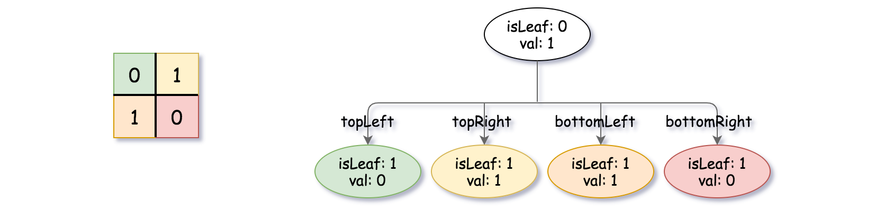
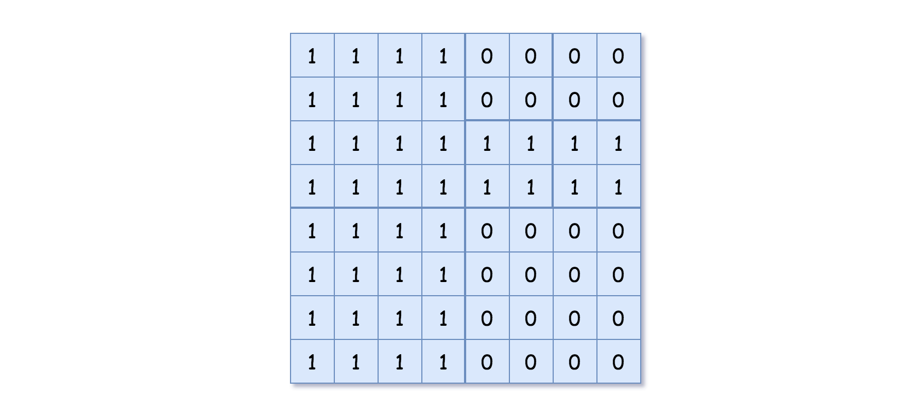
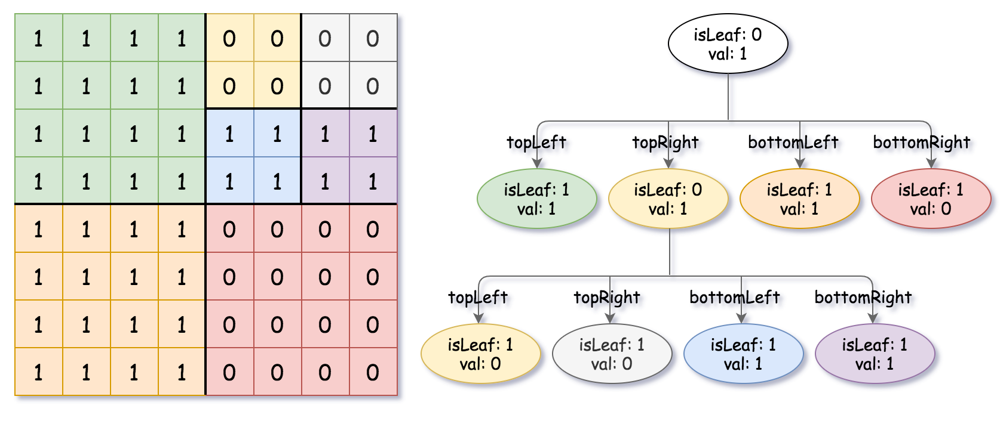

## 1. 题目描述

- [leetcode](https://leetcode.cn/problems/construct-quad-tree/)

给你一个 `n * n` 矩阵 `grid`，矩阵由若干 `0` 和 `1` 组成。请你用四叉树表示该矩阵 `grid`。

你需要返回能表示矩阵 `grid` 的 [四叉树][1] 的根结点。

四叉树数据结构中，每个内部节点只有四个子节点。此外，每个节点都有两个属性：

- `val`：储存叶子结点所代表的区域的值。1 对应 True，0 对应 False。注意，当 `isLeaf` 为 False 时，你可以把 True 或者 False 赋值给节点，两种值都会被判题机制接受。
- `isLeaf`: 当这个节点是一个叶子结点时为 True，如果它有 4 个子节点则为 False。

```java
class Node {
  public boolean val;
  public boolean isLeaf;
  public Node topLeft;
  public Node topRight;
  public Node bottomLeft;
  public Node bottomRight;
}
```

我们可以按以下步骤为二维区域构建四叉树：

1. 如果当前网格的值相同（即，全为 `0` 或者全为 `1`），将 `isLeaf` 设为 True，将 `val` 设为网格相应的值，并将四个子节点都设为 Null 然后停止。
2. 如果当前网格的值不同，将 `isLeaf` 设为 False， 将 `val` 设为任意值，然后如下图所示，将当前网格划分为四个子网格。
3. 使用适当的子网格递归每个子节点。


如果你想了解更多关于四叉树的内容，可以参考 [百科][1]。

---

四叉树格式：

你不需要阅读本节来解决这个问题。只有当你想了解输出格式时才会这样做。输出为使用层序遍历后四叉树的序列化形式，其中 `null` 表示路径终止符，其下面不存在节点。

它与二叉树的序列化非常相似。唯一的区别是节点以列表形式表示 `[isLeaf, val]`。

如果 `isLeaf` 或者 `val` 的值为 True，则表示它在列表 `[isLeaf, val]` 中的值为 1；如果 `isLeaf` 或者 `val` 的值为 False，则表示值为 0。

---

示例 1：


```txt
输入：grid = [
  [0, 1],
  [1, 0]
]
输出：[
  [0, 1],
  [1, 0],
  [1, 1],
  [1, 1],
  [1, 0]
]
```

解释：此示例的解释如下：

请注意，在下面四叉树的图示中，0 表示 false，1 表示 True。



---

示例 2：



```txt
输入：grid = [
  [1, 1, 1, 1, 0, 0, 0, 0],
  [1, 1, 1, 1, 0, 0, 0, 0],
  [1, 1, 1, 1, 1, 1, 1, 1],
  [1, 1, 1, 1, 1, 1, 1, 1],
  [1, 1, 1, 1, 0, 0, 0, 0],
  [1, 1, 1, 1, 0, 0, 0, 0],
  [1, 1, 1, 1, 0, 0, 0, 0],
  [1, 1, 1, 1, 0, 0, 0, 0]
]
输出：[
  [0, 1],
  [1, 1],
  [0, 1],
  [1, 1],
  [1, 0],
  null,
  null,
  null,
  null,
  [1, 0],
  [1, 0],
  [1, 1],
  [1, 1]
]
```

解释：网格中的所有值都不相同。我们将网格划分为四个子网格。

topLeft，bottomLeft 和 bottomRight 均具有相同的值。

topRight 具有不同的值，因此我们将其再分为 4 个子网格，这样每个子网格都具有相同的值。

解释如下图所示：



---

提示：

1. `n == grid.length == grid[i].length`
2. `n == 2^x` 其中 `0 <= x <= 6`

## 2. s.1 - 递归（自底向上）

::: code-group

```js [js]
/**
 * // Definition for a QuadTree node.
 * function _Node(val,isLeaf,topLeft,topRight,bottomLeft,bottomRight) {
 *    this.val = val;
 *    this.isLeaf = isLeaf;
 *    this.topLeft = topLeft;
 *    this.topRight = topRight;
 *    this.bottomLeft = bottomLeft;
 *    this.bottomRight = bottomRight;
 * };
 */

/**
 * @param {number[][]} grid
 * @return {_Node}
 */
var construct = function (grid) {
  const build = (r, c, size) => {
    if (size === 1) return new _Node(grid[r][c] === 1, true)
    const half = size >> 1
    const tl = build(r, c, half)
    const tr = build(r, c + half, half)
    const bl = build(r + half, c, half)
    const br = build(r + half, c + half, half)
    if (
      tl.isLeaf &&
      tr.isLeaf &&
      bl.isLeaf &&
      br.isLeaf &&
      tl.val === tr.val &&
      tr.val === bl.val &&
      bl.val === br.val
    ) {
      return new _Node(tl.val, true)
    }
    return new _Node(true, false, tl, tr, bl, br)
  }
  return build(0, 0, grid.length)
}
```

```py [py]
"""
# Definition for a QuadTree node.
class Node:
    def __init__(self, val, isLeaf, topLeft, topRight, bottomLeft, bottomRight):
        self.val = val
        self.isLeaf = isLeaf
        self.topLeft = topLeft
        self.topRight = topRight
        self.bottomLeft = bottomLeft
        self.bottomRight = bottomRight
"""

class Solution:
    def construct(self, grid: List[List[int]]) -> 'Node':
        def build(r, c, size):
            if size == 1:
                return Node(grid[r][c] == 1, True)
            half = size // 2
            tl = build(r, c, half)
            tr = build(r, c + half, half)
            bl = build(r + half, c, half)
            br = build(r + half, c + half, half)
            if tl.isLeaf and tr.isLeaf and bl.isLeaf and br.isLeaf and tl.val == tr.val == bl.val == br.val:
                return Node(tl.val, True)
            return Node(True, False, tl, tr, bl, br)
        return build(0, 0, len(grid))
```

:::

- 时间复杂度：$O(n^2 \log n)$，其中 $n$ 是矩阵边长
- 空间复杂度：$O(\log n)$，递归栈

算法思路：

- 递归分治：将矩阵四等分，分别构建子树
- 若四个子节点都是叶子且值相同，合并为一个叶子

### 2.1. 用「示例 1」走一遍

s.1 是自底向上建：先一直拆到单个格子（一定是叶子），再看四个子节点。若四个都是叶子且值相同，就合并成一个叶子，丢掉这四个子节点；否则做成内部节点，挂上这四个孩子。内部节点的 `val` 随便填，代码里写的是 `true`。

用示例 1 走一遍：

```
grid = [
  [0, 1],
  [1, 0]
]
```

边长是 2，先拆成四个 1×1 的叶子：左上 `0`、右上 `1`、左下 `1`、右下 `0`。四个值不全相同，不能合并，所以根是内部节点，四个孩子都保留。层序输出就是：

```
[0, 1]   根：不是叶子，val 任意
[1, 0]   左上叶子 0
[1, 1]   右上叶子 1
[1, 1]   左下叶子 1
[1, 0]   右下叶子 0
```

示例 2 也一样：整张图不统一，先切成四块。左上、左下、右下各自全是 1 或全是 0，直接做成叶子；右上那块还有 0 和 1，再切成四个叶子。

## 3. 引用

- [四叉树 - 百度百科][1]

[1]: https://baike.baidu.com/item/%E5%9B%9B%E5%8F%89%E6%A0%91
