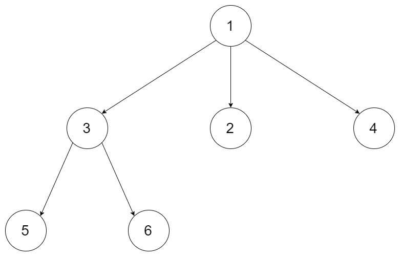
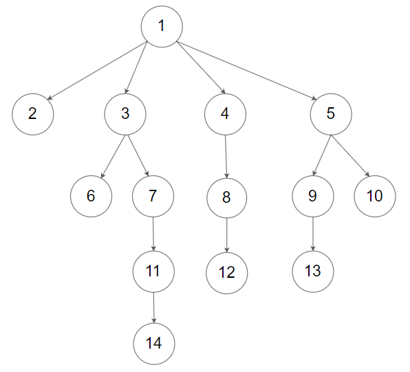

## 1. 题目描述

- [leetcode](https://leetcode.cn/problems/n-ary-tree-level-order-traversal/)

给定一个 N 叉树，返回其节点值的层序遍历。（即从左到右，逐层遍历）。

树的序列化输入是用层序遍历，每组子节点都由 null 值分隔（参见示例）。

---

示例 1：



```txt
输入：root = [1, null, 3, 2, 4, null, 5, 6]
输出：[[1], [3, 2, 4], [5, 6]]
```

---

示例 2：



```txt
输入：root = [
  1, null, 2, 3, 4, 5, null, null, 6, 7, null, 8, null, 9, 10,
  null, null, 11, null, 12, null, 13, null, null, 14
]
输出：[
  [1],
  [2, 3, 4, 5],
  [6, 7, 8, 9, 10],
  [11, 12, 13],
  [14]
]
```

---

提示：

- 树的高度不会超过 `1000`
- 树的节点总数在 `[0, 10^4]` 之间

## 2. s.1 - BFS

::: code-group

```c [c]
/**
 * Definition for a Node.
 * struct Node {
 *     int val;
 *     int numChildren;
 *     struct Node** children;
 * };
 */

/**
 * Return an array of arrays of size *returnSize.
 * The sizes of the arrays are returned as *returnColumnSizes array.
 * Note: Both returned array and *columnSizes array must be malloced, assume caller calls free().
 */
 int** levelOrder(struct Node* root, int* returnSize, int** returnColumnSizes) {
    *returnSize = 0;
    if (!root) { *returnColumnSizes = NULL; return NULL; }
    int** res = (int**)malloc(sizeof(int*) * 1000);
    *returnColumnSizes = (int*)malloc(sizeof(int) * 1000);
    struct Node* queue[10000];
    int front = 0, rear = 0;
    queue[rear++] = root;
    while (front < rear) {
        int size = rear - front;
        res[*returnSize] = (int*)malloc(sizeof(int) * size);
        (*returnColumnSizes)[*returnSize] = size;
        for (int i = 0; i < size; i++) {
            struct Node* node = queue[front++];
            res[*returnSize][i] = node->val;
            for (int j = 0; j < node->numChildren; j++)
                queue[rear++] = node->children[j];
        }
        (*returnSize)++;
    }
    return res;
}
```

```js [js]
/**
 * // Definition for a _Node.
 * function _Node(val,children) {
 *    this.val = val;
 *    this.children = children;
 * };
 */

/**
 * @param {_Node|null} root
 * @return {number[][]}
 */
var levelOrder = function (root) {
  if (!root) return []
  const res = [],
    queue = [root]
  while (queue.length) {
    const size = queue.length,
      level = []
    for (let i = 0; i < size; i++) {
      const node = queue.shift()
      level.push(node.val)
      for (const child of node.children) queue.push(child)
    }
    res.push(level)
  }
  return res
}
```

```py [py]
"""
# Definition for a Node.
class Node:
    def __init__(self, val: Optional[int] = None, children: Optional[List['Node']] = None):
        self.val = val
        self.children = children
"""

class Solution:
    def levelOrder(self, root: 'Node') -> List[List[int]]:
        if not root:
            return []
        res, queue = [], [root]
        while queue:
            level = []
            for _ in range(len(queue)):
                node = queue.pop(0)
                level.append(node.val)
                queue.extend(node.children)
            res.append(level)
        return res
```

:::

- 时间复杂度：$O(n)$，其中 $n$ 是节点数
- 空间复杂度：$O(n)$

算法思路：

- 标准 BFS 层序遍历，每层收集节点值
- 将当前节点的所有子节点加入队列
