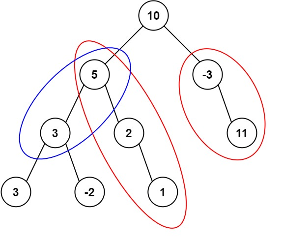

## 1. 题目描述

- [leetcode](https://leetcode.cn/problems/path-sum-iii/)

给定一个二叉树的根节点 `root`，和一个整数 `targetSum`，求该二叉树里节点值之和等于 `targetSum` 的 **路径** 的数目。

**路径** 不需要从根节点开始，也不需要在叶子节点结束，但是路径方向必须是向下的（只能从父节点到子节点）。

---

示例 1：



```txt
输入：root = [10, 5, -3, 3, 2, null, 11, 3, -2, null, 1], targetSum = 8
输出：3
解释：和等于 8 的路径有 3 条，如图所示。
```

---

示例 2：

```txt
输入：root = [
  5, 4, 8, 11, null, 13, 4, 7, 2, null, null, 5, 1
], targetSum = 22
输出：3
```

---

提示：

- 二叉树的节点个数的范围是 `[0,1000]`
- `-10^9 <= Node.val <= 10^9`
- `-1000 <= targetSum <= 1000`

## 2. s.1 - 前缀和 + 哈希表

::: code-group

```c [c]
/**
 * Definition for a binary tree node.
 * struct TreeNode {
 *     int val;
 *     struct TreeNode *left;
 *     struct TreeNode *right;
 * };
 */
#define HASH_SIZE 100003
typedef struct Entry { long long key; int val; struct Entry* next; } Entry;

Entry* table[HASH_SIZE];

int hashIdx(long long key) { return (int)(((unsigned long long)key) % HASH_SIZE); }

void put(long long key, int val) {
    int idx = hashIdx(key);
    for (Entry* e = table[idx]; e; e = e->next)
        if (e->key == key) { e->val = val; return; }
    Entry* e = (Entry*)malloc(sizeof(Entry));
    e->key = key; e->val = val; e->next = table[idx]; table[idx] = e;
}

int get(long long key) {
    int idx = hashIdx(key);
    for (Entry* e = table[idx]; e; e = e->next)
        if (e->key == key) return e->val;
    return 0;
}

int count;

void dfs(struct TreeNode* node, long long prefix, int targetSum) {
    if (!node) return;
    prefix += node->val;
    count += get(prefix - targetSum);
    put(prefix, get(prefix) + 1);
    dfs(node->left, prefix, targetSum);
    dfs(node->right, prefix, targetSum);
    put(prefix, get(prefix) - 1);
}

int pathSum(struct TreeNode* root, int targetSum) {
    memset(table, 0, sizeof(table));
    count = 0;
    put(0, 1);
    dfs(root, 0, targetSum);
    // free hash
    for (int i = 0; i < HASH_SIZE; i++) {
        Entry* e = table[i];
        while (e) { Entry* t = e; e = e->next; free(t); }
    }
    return count;
}
```

```js [js]
/**
 * Definition for a binary tree node.
 * function TreeNode(val, left, right) {
 *     this.val = (val===undefined ? 0 : val)
 *     this.left = (left===undefined ? null : left)
 *     this.right = (right===undefined ? null : right)
 * }
 */
/**
 * @param {TreeNode} root
 * @param {number} targetSum
 * @return {number}
 */
var pathSum = function (root, targetSum) {
  const map = new Map([[0, 1]])
  let count = 0
  const dfs = (node, prefix) => {
    if (!node) return
    prefix += node.val
    count += map.get(prefix - targetSum) || 0
    map.set(prefix, (map.get(prefix) || 0) + 1)
    dfs(node.left, prefix)
    dfs(node.right, prefix)
    map.set(prefix, map.get(prefix) - 1)
  }
  dfs(root, 0)
  return count
}
```

```py [py]
# Definition for a binary tree node.
# class TreeNode:
#     def __init__(self, val=0, left=None, right=None):
#         self.val = val
#         self.left = left
#         self.right = right
class Solution:
    def pathSum(self, root: Optional[TreeNode], targetSum: int) -> int:
        prefix = defaultdict(int)
        prefix[0] = 1
        self.count = 0
        def dfs(node, cur_sum):
            if not node:
                return
            cur_sum += node.val
            self.count += prefix[cur_sum - targetSum]
            prefix[cur_sum] += 1
            dfs(node.left, cur_sum)
            dfs(node.right, cur_sum)
            prefix[cur_sum] -= 1
        dfs(root, 0)
        return self.count
```

:::

- 时间复杂度：$O(n)$，其中 $n$ 是节点数
- 空间复杂度：$O(n)$

算法思路：

- DFS 过程中维护根到当前节点的前缀和
- 哈希表记录前缀和出现次数，查找 `prefix - targetSum` 是否存在
- 回溯时恢复哈希表

### 用「示例 1」走一遍流程

s.1 用前缀和：DFS 时记下「根到当前节点」的路径和 `prefix`。若上面某个祖先处的前缀和等于 `prefix - targetSum`，那从它的下一层到当前节点，这一段的和就是目标值。用哈希表统计当前这条根路径上各前缀和出现了几次，回溯时再减掉，避免影响到其他分支。一开始放入 `0` 出现 1 次，用来覆盖从根开始的路径（比如根节点恰好就是 `targetSum`）。

用示例 1、`targetSum = 8` 走一遍：

```
        0 -> 相当于是一个虚节点
        |
        10
       /  \
      5   -3
     / \    \
    3   2    11
   / \   \
  3  -2   1
```

先走到 `10`，前缀和 10，没有 `10 - 8 = 2`。再走到 `5`，前缀和 15，没有 7。再走到左边的 `3`，前缀和 18，表里有 10，说明 `5 → 3` 这一段是 8，计 1 条。...（省略后续 3、-2 无效的查找）

回到 `5` 后走 `2 → 1`，到达 `1` 时前缀和又是 18，同样能找到 10，对应 `5 → 2 → 1`，计 2 条。

另一边走到 `-3 → 11`，到达 `11` 时前缀和也是 18，再次找到 10，对应 `-3 → 11`，共 3 条。
