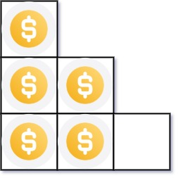
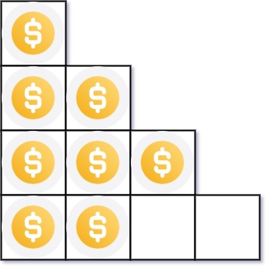

## 1. 题目描述

- [leetcode](https://leetcode.cn/problems/arranging-coins/)

你总共有 `n` 枚硬币，并计划将它们按阶梯状排列。对于一个由 `k` 行组成的阶梯，其第 `i` 行必须正好有 `i` 枚硬币。阶梯的最后一行 **可能** 是不完整的。

给你一个数字 `n`，计算并返回可形成 **完整阶梯行** 的总行数。

---

示例 1：



```txt
输入：n = 5
输出：2
解释：因为第三行不完整，所以返回 2。
```

示例 2：



```txt
输入：n = 8
输出：3
解释：因为第四行不完整，所以返回 3。
```

---

提示：

- `1 <= n <= 2^31 - 1`

## 2. s.1 - 二分 + 等差数列公式

::: code-group

```c [c]
int arrangeCoins(int n) {
    long left = 1, right = n;

    while (left <= right) {
        long mid = left + (right - left) / 2;
        long coins = mid * (mid + 1) / 2;

        if (coins == n) {
            return (int)mid;
        } else if (coins < n) {
            left = mid + 1;
        } else {
            right = mid - 1;
        }
    }

    return (int)right;
}
```

```js [js]
/**
 * @param {number} n
 * @return {number}
 */
var arrangeCoins = function (n) {
  let left = 1
  let right = n

  while (left <= right) {
    const mid = Math.floor((left + right) / 2)
    const coins = (mid * (mid + 1)) / 2

    if (coins === n) {
      return mid
    } else if (coins < n) {
      left = mid + 1
    } else {
      right = mid - 1
    }
  }

  return right
}
```

```py [py]
class Solution:
    def arrangeCoins(self, n: int) -> int:
        left, right = 1, n

        while left <= right:
            mid = (left + right) // 2
            coins = mid * (mid + 1) // 2

            if coins == n:
                return mid
            elif coins < n:
                left = mid + 1
            else:
                right = mid - 1

        return right
```

:::

- 时间复杂度：$O(\log n)$，在 $[1, n]$ 上二分查找
- 空间复杂度：$O(1)$，只用常数额外空间

算法思路：

- 排满 $k$ 行需要的硬币数为等差数列和 $k(k+1)/2$
- 目标是找最大的 $k$，满足 $k(k+1)/2 \le n$
- 所需硬币数随 $k$ 单调递增，可在 $[1, n]$ 上二分
- 若 mid 行所需小于 $n$，向右找更大行数；若大于 $n$，向左缩小；恰好相等则直接返回
- 循环结束时 `right` 落在最后一个满足条件的 $k$ 上
