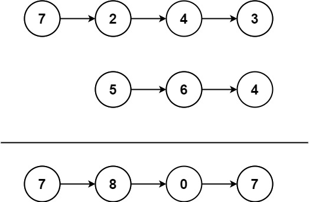

## 1. 题目描述

- [leetcode](https://leetcode.cn/problems/add-two-numbers-ii/)

给你两个 **非空** 链表来代表两个非负整数。数字最高位位于链表开始位置。它们的每个节点只存储一位数字。将这两数相加会返回一个新的链表。

你可以假设除了数字 0 之外，这两个数字都不会以零开头。

---

示例 1：



```txt
输入：l1 = [7, 2, 4, 3], l2 = [5, 6, 4]
输出：[7, 8, 0, 7]
```

---

示例 2：

```txt
输入：l1 = [2, 4, 3], l2 = [5, 6, 4]
输出：[8, 0, 7]
```

---

示例 3：

```txt
输入：l1 = [0], l2 = [0]
输出：[0]
```

---

提示：

- 链表的长度范围为 `[1, 100]`
- `0 <= node.val <= 9`
- 输入数据保证链表代表的数字无前导 0

---

进阶：如果输入链表不能翻转该如何解决？

## 2. s.1 - 栈

::: code-group

```c [c]
/**
 * Definition for singly-linked list.
 * struct ListNode {
 *     int val;
 *     struct ListNode *next;
 * };
 */
 struct ListNode* addTwoNumbers(struct ListNode* l1, struct ListNode* l2) {
    int s1[100], s2[100], t1 = 0, t2 = 0;
    while (l1) { s1[t1++] = l1->val; l1 = l1->next; }
    while (l2) { s2[t2++] = l2->val; l2 = l2->next; }
    int carry = 0;
    struct ListNode* head = NULL;
    while (t1 > 0 || t2 > 0 || carry) {
        int sum = carry;
        if (t1 > 0) sum += s1[--t1];
        if (t2 > 0) sum += s2[--t2];
        carry = sum / 10;
        struct ListNode* node = (struct ListNode*)malloc(sizeof(struct ListNode));
        node->val = sum % 10;
        node->next = head;
        head = node;
    }
    return head;
}
```

```js [js]
/**
 * Definition for singly-linked list.
 * function ListNode(val, next) {
 *     this.val = (val===undefined ? 0 : val)
 *     this.next = (next===undefined ? null : next)
 * }
 */
/**
 * @param {ListNode} l1
 * @param {ListNode} l2
 * @return {ListNode}
 */
var addTwoNumbers = function (l1, l2) {
  const s1 = [],
    s2 = []
  while (l1) {
    s1.push(l1.val)
    l1 = l1.next
  }
  while (l2) {
    s2.push(l2.val)
    l2 = l2.next
  }
  let carry = 0,
    head = null
  while (s1.length || s2.length || carry) {
    const sum = (s1.pop() || 0) + (s2.pop() || 0) + carry
    carry = Math.floor(sum / 10)
    const node = new ListNode(sum % 10)
    node.next = head
    head = node
  }
  return head
}
```

```py [py]
# Definition for singly-linked list.
# class ListNode:
#     def __init__(self, val=0, next=None):
#         self.val = val
#         self.next = next
class Solution:
    def addTwoNumbers(self, l1: Optional[ListNode], l2: Optional[ListNode]) -> Optional[ListNode]:
        s1, s2 = [], []
        while l1:
            s1.append(l1.val)
            l1 = l1.next
        while l2:
            s2.append(l2.val)
            l2 = l2.next
        carry, head = 0, None
        while s1 or s2 or carry:
            total = (s1.pop() if s1 else 0) + (s2.pop() if s2 else 0) + carry
            carry = total // 10
            node = ListNode(total % 10)
            node.next = head
            head = node
        return head
```

:::

- 时间复杂度：$O(\max(m, n))$
- 空间复杂度：$O(m + n)$

算法思路：

- 将两个链表分别压入栈，从低位开始相加
- 用头插法构建结果链表，处理进位

### 2.1. 用「示例 1」过一遍流程

s.1 用两个栈解决顺序问题：依次把链表中的数字入栈，弹出时就能先拿到个位，不需要翻转输入链表。

以 `7243 + 564` 为例，两个栈分别是 `[7, 2, 4, 3]` 和 `[5, 6, 4]`，从末尾弹出：

- 个位：`3 + 4 = 7`，结果链表为 `7`。
- 十位：`4 + 6 = 10`，本位写 `0`，进位 `1`，结果为 `0 → 7`。
- 百位：`2 + 5 + 1 = 8`，结果为 `8 → 0 → 7`。
- 千位：另一边已空，按 `0` 算，`7 + 0 = 7`，结果为 `7 → 8 → 0 → 7`。

**每次算出的新节点都插在结果链表最前面**，因为先算出的是低位，后算出的是高位。代码里的 `node.next = head`、`head = node` 就是这个操作。

循环条件还包含 `carry`，是为了处理最后的进位，例如 `9 + 1`：先得到节点 `0`，再补一个头节点 `1`，结果才是 `1 → 0`。
