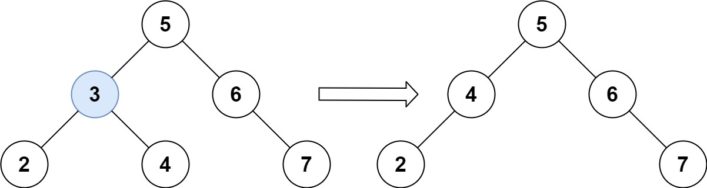
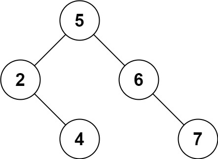

## 1. 题目描述

- [leetcode](https://leetcode.cn/problems/delete-node-in-a-bst/)

给定一个二叉搜索树的根节点 root 和一个值 key，删除二叉搜索树中的 key 对应的节点，并保证二叉搜索树的性质不变。返回二叉搜索树（有可能被更新）的根节点的引用。

一般来说，删除节点可分为两个步骤：

1. 首先找到需要删除的节点；
2. 如果找到了，删除它。

---

示例 1：



```txt
输入：root = [5, 3, 6, 2, 4, null, 7], key = 3
输出：[5, 4, 6, 2, null, null, 7]
解释：给定需要删除的节点值是 3，所以我们首先找到 3 这个节点，然后删除它。
一个正确的答案是 [5, 4, 6, 2, null, null, 7], 如下图所示。
另一个正确答案是 [5, 2, 6, null, 4, null, 7]。
```



---

示例 2：

```txt
输入: root = [5, 3, 6, 2, 4, null, 7], key = 0
输出: [5, 3, 6, 2, 4, null, 7]
解释: 二叉树不包含值为 0 的节点
```

---

示例 3：

```txt
输入: root = [], key = 0
输出: []
```

---

提示：

- 节点数的范围 `[0, 10^4]`.
- `-10^5 <= Node.val <= 10^5`
- 节点值唯一
- `root` 是合法的二叉搜索树
- `-10^5 <= key <= 10^5`

---

进阶：要求算法时间复杂度为 O(h)，h 为树的高度。

## 2. s.1 - 递归

::: code-group

```c [c]
/**
 * Definition for a binary tree node.
 * struct TreeNode {
 *     int val;
 *     struct TreeNode *left;
 *     struct TreeNode *right;
 * };
 */
 struct TreeNode* deleteNode(struct TreeNode* root, int key) {
    if (!root) return NULL;
    if (key < root->val) {
        root->left = deleteNode(root->left, key);
    } else if (key > root->val) {
        root->right = deleteNode(root->right, key);
    } else {
        if (!root->left) { struct TreeNode* r = root->right; free(root); return r; }
        if (!root->right) { struct TreeNode* l = root->left; free(root); return l; }
        struct TreeNode* succ = root->right;
        while (succ->left) succ = succ->left;
        root->val = succ->val;
        root->right = deleteNode(root->right, succ->val);
    }
    return root;
}
```

```js [js]
/**
 * Definition for a binary tree node.
 * function TreeNode(val, left, right) {
 *     this.val = (val===undefined ? 0 : val)
 *     this.left = (left===undefined ? null : left)
 *     this.right = (right===undefined ? null : right)
 * }
 */
/**
 * @param {TreeNode} root
 * @param {number} key
 * @return {TreeNode}
 */
var deleteNode = function (root, key) {
  if (!root) return null
  if (key < root.val) {
    root.left = deleteNode(root.left, key)
  } else if (key > root.val) {
    root.right = deleteNode(root.right, key)
  } else {
    if (!root.left) return root.right
    if (!root.right) return root.left
    // 找右子树最小节点
    let successor = root.right
    while (successor.left) successor = successor.left
    root.val = successor.val
    root.right = deleteNode(root.right, successor.val)
  }
  return root
}
```

```py [py]
# Definition for a binary tree node.
# class TreeNode:
#     def __init__(self, val=0, left=None, right=None):
#         self.val = val
#         self.left = left
#         self.right = right
class Solution:
    def deleteNode(self, root: Optional[TreeNode], key: int) -> Optional[TreeNode]:
        if not root:
            return None
        if key < root.val:
            root.left = self.deleteNode(root.left, key)
        elif key > root.val:
            root.right = self.deleteNode(root.right, key)
        else:
            if not root.left:
                return root.right
            if not root.right:
                return root.left
            succ = root.right
            while succ.left:
                succ = succ.left
            root.val = succ.val
            root.right = self.deleteNode(root.right, succ.val)
        return root
```

:::

- 时间复杂度：$O(h)$，其中 $h$ 是树的高度
- 空间复杂度：$O(h)$

算法思路：

- 递归查找目标节点，找到后分三种情况处理
- 若无左子树或无右子树，直接用另一侧替代
- 若左右子树都存在，用右子树最小节点（后继）替代当前节点，再递归删除后继

s.1 先按 BST 查找：`key` 小于当前值就进左子树，大于就进右子树，并把递归返回值接回对应孩子。找到之后分三种情况：

- 情况 1：没有左孩子：直接用右孩子顶上（叶子也属于这种，两边都空，相当于删掉）。
- 情况 2：没有右孩子：直接用左孩子顶上。
- 情况 3：左右都有：用后继（右子树里最小的节点）的值覆盖当前节点，再在右子树里把那个后继删掉。后继没有左孩子，**第二次删除一定是「情况 1：没有左孩子」的情况**。

用示例 1 删除 `3` 走一遍。原树是根 `5`，左子树 `3`（再往下是 `2`、`4`），右子树 `6`（右边是 `7`）。`3` 左右都有孩子，右子树最小的是 `4`，把 `3` 改成 `4` 后再删掉原来的 `4`，得到 `[5, 4, 6, 2, null, null, 7]`。

题目里另一个正确答案是用前驱（左子树最大值 `2`）去顶替，笔记这版没有走这条路，但两种都合法。
