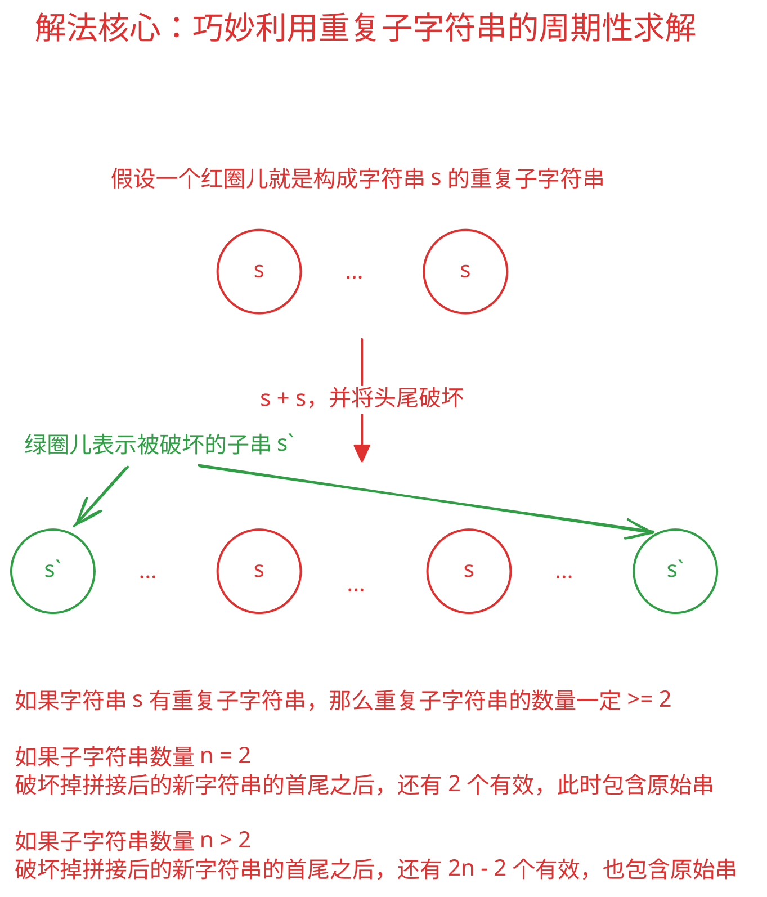

## 1. 题目描述

- [leetcode](https://leetcode.cn/problems/repeated-substring-pattern/)

给定一个非空的字符串 `s`，检查是否可以通过由它的一个子串重复多次构成。

---

示例 1：

```txt
输入: s = "abab"
输出: true
解释: 可由子串 "ab" 重复两次构成。
```

---

示例 2：

```txt
输入: s = "aba"
输出: false
```

---

示例 3：

```txt
输入: s = "abcabcabcabc"
输出: true
解释: 可由子串 "abc" 重复四次构成。 (或子串 "abcabc" 重复两次构成。)
```

---

提示：

- `1 <= s.length <= 10^4`
- `s` 由小写英文字母组成

## 2. s.1 - 字符串拼接法



::: code-group

```c [c]
bool repeatedSubstringPattern(char* s) {
    int n = strlen(s);
    if (n < 2)
        return false;

    char* combined = (char*)malloc((2 * n + 1) * sizeof(char));
    memcpy(combined, s, n);
    memcpy(combined + n, s, n);
    combined[2 * n] = '\0';
    combined[2 * n - 1] = '\0';

    bool found = strstr(combined + 1, s) != NULL;
    free(combined);
    return found;
}
```

```js [js]
/**
 * @param {string} s
 * @return {boolean}
 */
var repeatedSubstringPattern = function (s) {
  // 将字符串与自身拼接，去掉首字符和尾字符
  // 如果原字符串在其中出现，则说明可以由重复子串构成
  return (s + s).substring(1, 2 * s.length - 1).includes(s)
}
```

```py [py]
class Solution:
    def repeatedSubstringPattern(self, s: str) -> bool:
        return s in (s + s)[1:-1]
```

:::

- 时间复杂度：$O(n)$，其中 $n$ 是字符串 `s` 的长度，构造拼接串、去掉首尾字符以及在新字符串中查找 `s` 都只需线性处理字符
- 空间复杂度：$O(n)$，需要额外构造长度约为 $2n$ 的拼接字符串

算法思路：

- 设 $s$ 的长度为 $n$。若 $s$ 由某个子串重复至少两次构成，则存在周期 $p$，满足 $p < n$ 且 $p$ 整除 $n$
- 把 $s$ 与自身拼接得到 $ss$（长度为 $2n$）。由于周期为 $p$，$s$ 会在下标 $0, p, 2p, \ldots, n$ 处出现
- 去掉首尾字符后，起点为 $0$ 和 $n$ 的两处出现被破坏；但 $1 \le p \le n/2$，从下标 $p$ 开始的那一段仍完整落在中间，因此一定还能匹配到 $s$
- 若 $s$ 不能由重复子串构成，则 $ss$ 中 $s$ 只出现在 $0$ 和 $n$，去掉首尾后中间不会再出现 $s$
