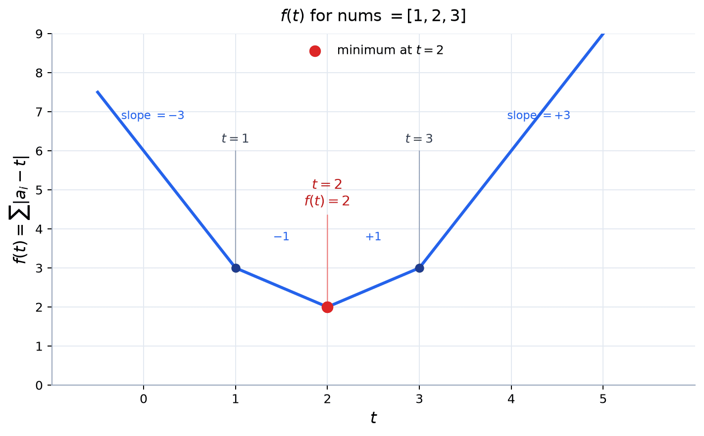
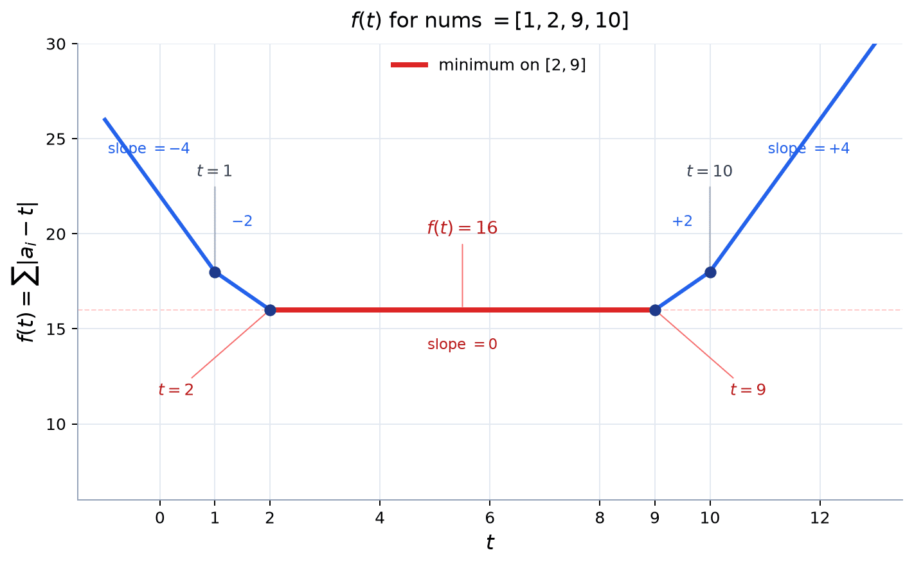

## 1. 题目描述

- [leetcode](https://leetcode.cn/problems/minimum-moves-to-equal-array-elements-ii/)

给你一个长度为 `n` 的整数数组 `nums`，返回使所有数组元素相等需要的最小操作数。

在一次操作中，你可以使数组中的一个元素加 `1` 或者减 `1`。

测试用例经过设计以使答案在 32 位整数范围内。

---

示例 1：

```txt
输入：nums = [1, 2, 3]
输出：2
解释：
只需要两次操作（每次操作指南使一个元素加 1 或减 1）：
[1, 2, 3]  =>  [2, 2, 3]  =>  [2, 2, 2]
```

---

示例 2：

```txt
输入：nums = [1, 10, 2, 9]
输出：16
```

---

提示：

- `n == nums.length`
- `1 <= nums.length <= 10^5`
- `-10^9 <= nums[i] <= 10^9`

## 2. s.1 - 中位数

::: code-group

```c [c]
int cmp(const void* a, const void* b) { return *(int*)a - *(int*)b; }

int minMoves2(int* nums, int numsSize) {
    qsort(nums, numsSize, sizeof(int), cmp);
    int mid = nums[numsSize / 2];
    int res = 0;
    for (int i = 0; i < numsSize; i++) res += abs(nums[i] - mid);
    return res;
}
```

```js [js]
/**
 * @param {number[]} nums
 * @return {number}
 */
var minMoves2 = function (nums) {
  nums.sort((a, b) => a - b)
  const mid = nums[nums.length >> 1]
  let res = 0
  for (const num of nums) res += Math.abs(num - mid)
  return res
}
```

```py [py]
class Solution:
    def minMoves2(self, nums: List[int]) -> int:
        nums.sort()
        mid = nums[len(nums) // 2]
        return sum(abs(x - mid) for x in nums)
```

:::

- 时间复杂度：$O(n \log n)$
- 空间复杂度：$O(\log n)$（排序开销）

算法思路：

- 将所有数移动到中位数的总操作次数最小
- 排序后取中位数，累加各元素与中位数的差的绝对值

### 2.1. 用配对理解 s.1 的正确性

首、尾两两配对，从最简单的场景思考：如果数组只有 2 项，即：线段上只有两个点 $a_1$ 和 $a_n$，要找一个 $t$，使得 $t$ 到 $a_1 + t$ 到 $a_n$ 的值最小，最优解一定落在 $[a_1, a_n]$ 内，此时两端的代价是常数 $a_n - a_1$。

同理，如果内部还有一对 $a_2$ 和 $a_{n-1}$，$t$ 也必须落在 $[a_2, a_{n-1}]$ 内。如此向内收缩，最后会收到唯一中位数，或收到偶数情况下的那一段平坦区间。

### 2.2. s.1 正确性的数学证明

一次操作是把某个数加 $1$ 或减 $1$，因此把所有数变成目标 $t$ 的代价为

$$f(t) = \sum_i |nums[i] - t|$$

只需证明 $f(t)$ 在中位数处取到最小值。

把数组排序为 $a_1 \le a_2 \le \cdots \le a_n$。对任意不与数组元素重合的 $t$，其左侧有 $L$ 个数、右侧有 $R$ 个数，且 $L + R = n$。$t$ 增大时，左边每个数的代价加 $1$，右边每个数的代价减 $1$，所以斜率是

$$f'(t) = L - R = 2L - n$$

- 当 $L < n/2$，即 $t$ 还在中位数左边时，斜率为负，$f$ 随 $t$ 增大而减小
- 当 $L > n/2$，即 $t$ 已在中位数右边时，斜率为正，$f$ 随 $t$ 增大而增大

因此最小值出现在中位数。

---

$n$ 为奇数时，中位数唯一，就是 $a_{(n+1)/2}$，也就是代码里的 $a[n/2]$（下标从 $0$ 起算）。

示例 1 是奇数个元素，最低点收成一个尖：$t=2$ 时 $f(t)=2$，左右斜率从 $-1$ 变成 $+1$。

 {w=711px}

---

$n$ 为偶数时，在两个中间数 $a_{n/2}$ 与 $a_{n/2+1}$ 之间有 $L = R = n/2$，斜率为 $0$，这段上 $f$ 都是最小值。代码取 $a[n/2]$（偏右的那个），落在这段里，所以也是最优。

下面是「示例 2」排序后 `[1, 2, 9, 10]` 的 $f(t)$ 坐标图：分段线性，在两个中位数 $t=2$ 和 $t=9$ 之间是一段水平最低线，代价都是 16。

 {w=711px}
