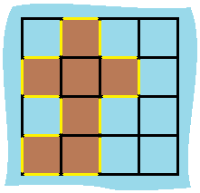

## 1. 题目描述

- [leetcode](https://leetcode.cn/problems/island-perimeter/)

给定一个 `row x col` 的二维网格地图 `grid`，其中：`grid[i][j] = 1` 表示陆地，`grid[i][j] = 0` 表示水域。

网格中的格子 **水平和垂直** 方向相连（对角线方向不相连）。整个网格被水完全包围，但其中恰好有一个岛屿（或者说，一个或多个表示陆地的格子相连组成的岛屿）。

岛屿中没有“湖”（“湖” 指水域在岛屿内部且不和岛屿周围的水相连）。格子是边长为 1 的正方形。网格为长方形，且宽度和高度均不超过 100。计算这个岛屿的周长。

---

示例 1：



```txt
输入：grid = [
  [0, 1, 0, 0],
  [1, 1, 1, 0],
  [0, 1, 0, 0],
  [1, 1, 0, 0]
]
输出：16
解释：它的周长是上面图片中的 16 个黄色的边
```

---

示例 2：

```txt
输入：grid = [[1]]
输出：4
```

---

示例 3：

```txt
输入：grid = [[1,0]]
输出：4
```

---

提示：

- `row == grid.length`
- `col == grid[i].length`
- `1 <= row, col <= 100`
- `grid[i][j]` 为 `0` 或 `1`

## 2. s.1 - 相邻边抵消

::: code-group

```c [c]
int islandPerimeter(int** grid, int gridSize, int* gridColSize) {
    int m = gridSize;
    int n = gridColSize[0];
    int lands = 0;
    int adjacent = 0;

    for (int i = 0; i < m; ++i) {
        for (int j = 0; j < n; ++j) {
            if (grid[i][j] == 0) {
                continue;
            }

            ++lands;
            if (i + 1 < m && grid[i + 1][j] == 1) {
                ++adjacent;
            }
            if (j + 1 < n && grid[i][j + 1] == 1) {
                ++adjacent;
            }
        }
    }

    return lands * 4 - adjacent * 2;
}
```

```js [js]
/**
 * @param {number[][]} grid
 * @return {number}
 */
var islandPerimeter = function (grid) {
  const m = grid.length
  const n = grid[0].length
  let lands = 0
  let adjacent = 0

  for (let i = 0; i < m; i++) {
    for (let j = 0; j < n; j++) {
      if (grid[i][j] === 0) continue

      lands++
      if (i + 1 < m && grid[i + 1][j] === 1) adjacent++ // 下方也是陆地
      if (j + 1 < n && grid[i][j + 1] === 1) adjacent++ // 右侧也是陆地
    }
  }

  return lands * 4 - adjacent * 2
}
```

```py [py]
class Solution:
    def islandPerimeter(self, grid: list[list[int]]) -> int:
        m, n = len(grid), len(grid[0])
        lands = 0
        adjacent = 0

        for i in range(m):
            for j in range(n):
                if grid[i][j] == 0:
                    continue

                lands += 1
                if i + 1 < m and grid[i + 1][j] == 1:
                    adjacent += 1
                if j + 1 < n and grid[i][j + 1] == 1:
                    adjacent += 1

        return lands * 4 - adjacent * 2
```

:::

- 时间复杂度：$O(mn)$，其中 $m$、$n$ 分别为网格的行数和列数，需要遍历整个网格
- 空间复杂度：$O(1)$，只用常数额外空间

算法思路：

- 设网格有 $m$ 行 $n$ 列，其中陆地格子共 $c$ 个。每块陆地单独来看有 $4$ 条边，周长先记为 $4c$
- 两块陆地共用一条边时，这条边不是岛屿的边界，却在 $4c$ 中被算了两次，需要减去 $2$
- 因此再统计水平或垂直相邻的陆地对数 $k$，周长即为 $4c - 2k$
- 遍历网格时，对每块陆地只检查右邻和下邻，避免同一条相邻边被重复计算
