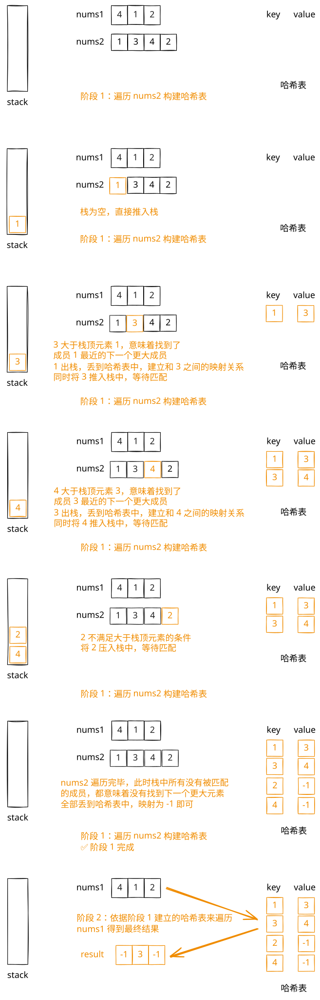
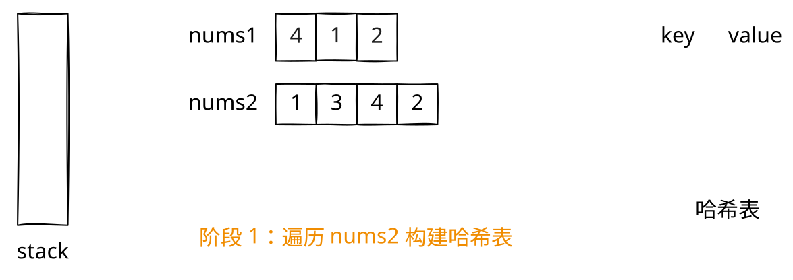
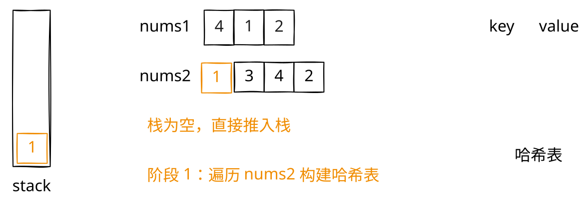
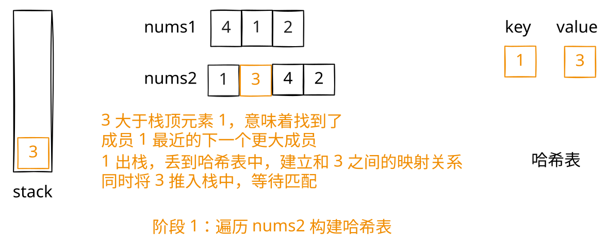
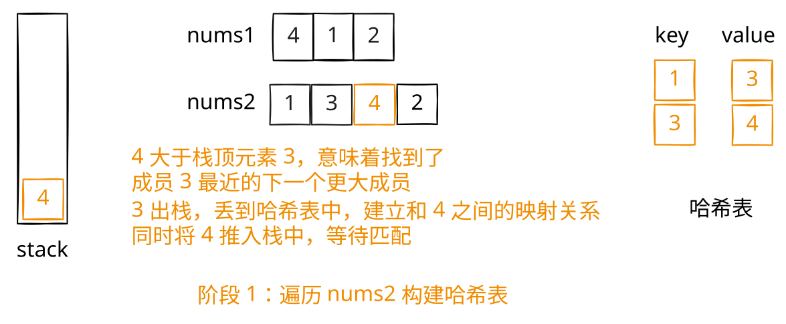
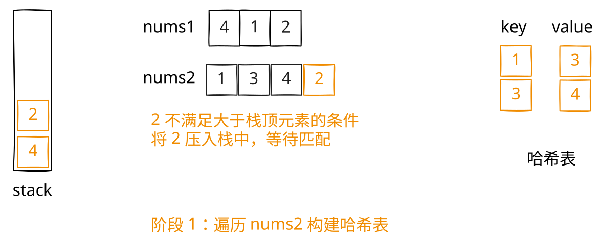
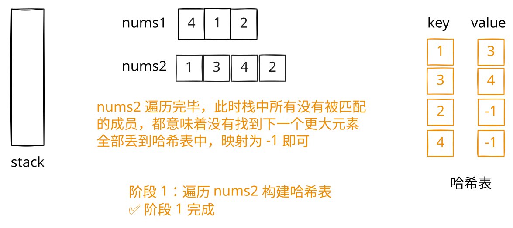
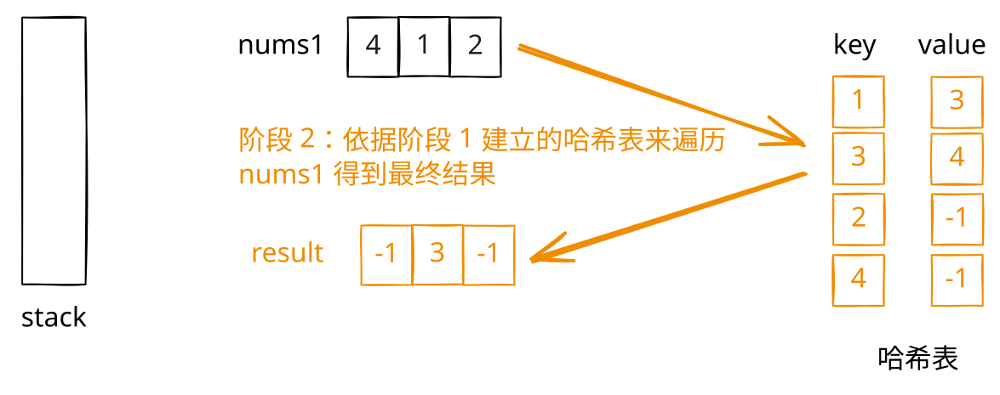

## 1. 题目描述

- [leetcode](https://leetcode.cn/problems/next-greater-element-i/)

`nums1` 中数字 `x` 的下一个更大元素是指 `x` 在 `nums2` 中对应位置右侧的第一个比 `x` 大的元素。

给你两个没有重复元素的数组 `nums1` 和 `nums2`，下标从 0 开始计数，其中`nums1` 是 `nums2` 的子集。

对于每个 `0 <= i < nums1.length`，找出满足 `nums1[i] == nums2[j]` 的下标 `j`，并且在 `nums2` 确定 `nums2[j]` 的下一个更大元素。如果不存在下一个更大元素，那么本次查询的答案是 `-1`。

返回一个长度为 `nums1.length` 的数组 `ans` 作为答案，满足 `ans[i]` 是如上所述的下一个更大元素。

---

示例 1：

```txt
输入：nums1 = [4, 1, 2], nums2 = [1, 3, 4, 2].
输出：[-1, 3, -1]
```

解释：nums1 中每个值的下一个更大元素如下所述：

- `4`，用高亮标识，nums2 = [1, 3, `4`, 2]。不存在下一个更大元素，所以答案是 -1。
- `1`，用高亮标识，nums2 = [`1`, 3, 4, 2]。下一个更大元素是 3。
- `2`，用高亮标识，nums2 = [1, 3, 4, `2`]。不存在下一个更大元素，所以答案是 -1。

---

示例 2：

```txt
输入：nums1 = [2, 4], nums2 = [1, 2, 3, 4].
输出：[3, -1]
```

解释：nums1 中每个值的下一个更大元素如下所述：

- `2`，用高亮标识，nums2 = [1, `2`, 3, 4]。下一个更大元素是 3。
- `4`，用高亮标识，nums2 = [1, 2, 3, `4`]。不存在下一个更大元素，所以答案是 -1。

---

提示：

- `1 <= nums1.length <= nums2.length <= 1000`
- `0 <= nums1[i], nums2[i] <= 10^4`
- `nums1` 和 `nums2` 中所有整数互不相同
- `nums1` 中的所有整数同样出现在 `nums2` 中

---

进阶：你可以设计一个时间复杂度为 `O(nums1.length + nums2.length)` 的解决方案吗？

## 2. s.1 - 单调栈 + 哈希表

::: details 完整图解
轮播中的图解是从以下这个完整图解中抽出来的子 svg。

:::

::: swiper















:::

::: code-group

```c [c]
/**
 * Note: The returned array must be malloced, assume caller calls free().
 */
int* nextGreaterElement(int* nums1, int nums1Size, int* nums2, int nums2Size, int* returnSize) {
    int stack[1000];
    int top = 0;
    int next[10001];
    for (int i = 0; i <= 10000; ++i) {
        next[i] = -1;
    }

    for (int i = 0; i < nums2Size; ++i) {
        int num = nums2[i];
        while (top > 0 && num > stack[top - 1]) {
            next[stack[--top]] = num;
        }
        stack[top++] = num;
    }

    int* ans = malloc(sizeof(int) * nums1Size);
    for (int i = 0; i < nums1Size; ++i) {
        ans[i] = next[nums1[i]];
    }
    *returnSize = nums1Size;
    return ans;
}
```

```js [js]
/**
 * @param {number[]} nums1
 * @param {number[]} nums2
 * @return {number[]}
 */
var nextGreaterElement = function (nums1, nums2) {
  const next = new Map()
  const stack = []

  for (const num of nums2) {
    while (stack.length > 0 && num > stack[stack.length - 1]) {
      next.set(stack.pop(), num)
    }
    stack.push(num)
  }

  return nums1.map((num) => (next.has(num) ? next.get(num) : -1))
}
```

```py [py]
class Solution:
    def nextGreaterElement(self, nums1: list[int], nums2: list[int]) -> list[int]:
        next_map = {}
        stack = []

        for num in nums2:
            while stack and num > stack[-1]:
                next_map[stack.pop()] = num
            stack.append(num)

        return [next_map.get(num, -1) for num in nums1]
```

:::

- 时间复杂度：$O(m + n)$，其中 $m$、$n$ 分别为 `nums1`、`nums2` 的长度；`nums2` 中每个元素至多入栈、出栈一次，再按 `nums1` 查表
- 空间复杂度：$O(n)$，栈和映射表最多存放 `nums2` 中的元素

算法思路：

- 设 `nums1`、`nums2` 的长度分别为 $m$、$n$。由于元素互不相同，可以先对 `nums2` 求出每个数右侧第一个更大的值，再按 `nums1` 查询
- 从左到右扫描 `nums2`，维护一个单调递减栈（栈顶最小）：若当前值比栈顶大，则它就是栈顶元素的下一个更大元素，将栈顶弹出并记录这对映射，直到栈空或栈顶不再更小，再把当前值入栈
- 扫描结束后，仍留在栈中的元素右侧没有更大的值，答案记为 $-1$
- 最后按 `nums1` 中的每个数查表，得到结果数组。例如 `nums2 = [1, 3, 4, 2]` 对应的映射为：$1 \mapsto 3$，$3 \mapsto 4$，$4 \mapsto -1$，$2 \mapsto -1$
