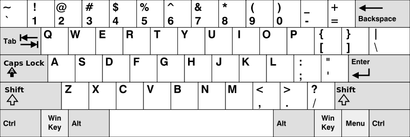

## 1. 题目描述

- [leetcode](https://leetcode.cn/problems/keyboard-row/)

给你一个字符串数组 `words`，只返回可以使用在美式键盘同一行的字母打印出来的单词。键盘如下图所示。

请注意，字符串不区分大小写，相同字母的大小写形式都被视为在同一行。

美式键盘中：

- 第一行由字符 `"qwertyuiop"` 组成。
- 第二行由字符 `"asdfghjkl"` 组成。
- 第三行由字符 `"zxcvbnm"` 组成。

 {w=800px}

---

示例 1：

```txt
输入：words = ["Hello", "Alaska", "Dad", "Peace"]
输出：["Alaska", "Dad"]

解释：
由于不区分大小写，"a" 和 "A" 都在美式键盘的第二行。
```

---

示例 2：

```txt
输入：words = ["omk"]
输出：[]
```

---

示例 3：

```txt
输入：words = ["adsdf", "sfd"]
输出：["adsdf", "sfd"]
```

---

提示：

- `1 <= words.length <= 20`
- `1 <= words[i].length <= 100`
- `words[i]` 由英文字母（小写和大写字母）组成

## 2. s.1 - 字母行号映射

::: code-group

```c [c]
/**
 * Note: The returned array must be malloced, assume caller calls free().
 */
char** findWords(char** words, int wordsSize, int* returnSize) {
    int row[26] = {0};
    const char* rows[3] = {"qwertyuiop", "asdfghjkl", "zxcvbnm"};
    for (int r = 0; r < 3; ++r) {
        for (const char* p = rows[r]; *p; ++p) {
            row[*p - 97] = r + 1;
        }
    }

    char** ans = malloc(sizeof(char*) * wordsSize);
    int k = 0;
    for (int i = 0; i < wordsSize; ++i) {
        char* word = words[i];
        int c0 = word[0] | 32;
        int target = row[c0 - 97];
        int ok = 1;
        for (int j = 1; word[j]; ++j) {
            int c = word[j] | 32;
            if (row[c - 97] != target) {
                ok = 0;
                break;
            }
        }
        if (ok) {
            ans[k++] = word;
        }
    }

    *returnSize = k;
    return ans;
}
```

```js [js]
/**
 * @param {string[]} words
 * @return {string[]}
 */
var findWords = function (words) {
  const row = Array(26).fill(0)
  const rows = ['qwertyuiop', 'asdfghjkl', 'zxcvbnm']
  for (let r = 0; r < 3; r++) {
    for (const ch of rows[r]) {
      row[ch.charCodeAt(0) - 97] = r + 1
    }
  }

  return words.filter((word) => {
    const target = row[(word.charCodeAt(0) | 32) - 97]
    for (let i = 1; i < word.length; i++) {
      if (row[(word.charCodeAt(i) | 32) - 97] !== target) {
        return false
      }
    }
    return true
  })
}
```

```py [py]
class Solution:
    def findWords(self, words: list[str]) -> list[str]:
        row = [0] * 26
        for r, letters in enumerate(('qwertyuiop', 'asdfghjkl', 'zxcvbnm'), 1):
            for ch in letters:
                row[ord(ch) - 97] = r

        ans = []
        for word in words:
            target = row[(ord(word[0]) | 32) - 97]
            if all(row[(ord(ch) | 32) - 97] == target for ch in word):
                ans.append(word)
        return ans
```

:::

- 时间复杂度：$O(nm)$，其中 $n$ 为单词数，$m$ 为单词的最大长度，每个字符都要查一次行号
- 空间复杂度：$O(1)$，行号表大小固定为 $26$（不计返回数组）

算法思路：

- 先把键盘三行字母映射到行号，共 $26$ 个小写字母，查表时间为常数
- 对每个单词，将字母统一按小写查表，用首字母所在行去核对其余字符；全部相同则保留该单词
