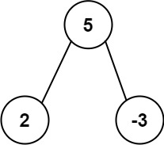

## 1. 题目描述

- [leetcode](https://leetcode.cn/problems/most-frequent-subtree-sum/)

给你一个二叉树的根结点 `root`，请返回出现次数最多的子树元素和。如果有多个元素出现的次数相同，返回所有出现次数最多的子树元素和（不限顺序）。

一个结点的 「子树元素和」 定义为以该结点为根的二叉树上所有结点的元素之和（包括结点本身）。

---

示例 1：



```txt
输入: root = [5, 2, -3]
输出: [2, -3, 4]
```

---

示例 2：


```txt
输入: root = [5, 2, -5]
输出: [2]
```

---

提示：

- 节点数在 `[1, 10^4]` 范围内
- `-10^5 <= Node.val <= 10^5`

## 2. s.1 - DFS + 哈希表

::: code-group

```c [c]
/**
 * Definition for a binary tree node.
 * struct TreeNode {
 *     int val;
 *     struct TreeNode *left;
 *     struct TreeNode *right;
 * };
 */
/**
 * Note: The returned array must be malloced, assume caller calls free().
 */
#define HASH_SIZE 10007
typedef struct Entry { int key; int val; struct Entry* next; } Entry;
Entry* table[HASH_SIZE];
int maxFreq;

void addFreq(int key) {
    int idx = ((unsigned int)key) % HASH_SIZE;
    for (Entry* e = table[idx]; e; e = e->next)
        if (e->key == key) { e->val++; if (e->val > maxFreq) maxFreq = e->val; return; }
    Entry* e = (Entry*)malloc(sizeof(Entry));
    e->key = key; e->val = 1; e->next = table[idx]; table[idx] = e;
    if (1 > maxFreq) maxFreq = 1;
}

int dfs(struct TreeNode* node) {
    if (!node) return 0;
    int sum = node->val + dfs(node->left) + dfs(node->right);
    addFreq(sum);
    return sum;
}

int* findFrequentTreeSum(struct TreeNode* root, int* returnSize) {
    memset(table, 0, sizeof(table));
    maxFreq = 0;
    dfs(root);
    int* res = (int*)malloc(sizeof(int) * 10000);
    *returnSize = 0;
    for (int i = 0; i < HASH_SIZE; i++)
        for (Entry* e = table[i]; e; e = e->next)
            if (e->val == maxFreq) res[(*returnSize)++] = e->key;
    // free
    for (int i = 0; i < HASH_SIZE; i++) {
        Entry* e = table[i];
        while (e) { Entry* t = e; e = e->next; free(t); }
    }
    return res;
}
```

```js [js]
/**
 * Definition for a binary tree node.
 * function TreeNode(val, left, right) {
 *     this.val = (val===undefined ? 0 : val)
 *     this.left = (left===undefined ? null : left)
 *     this.right = (right===undefined ? null : right)
 * }
 */
/**
 * @param {TreeNode} root
 * @return {number[]}
 */
var findFrequentTreeSum = function (root) {
  const freq = new Map()
  let maxFreq = 0
  const dfs = (node) => {
    if (!node) return 0
    const sum = node.val + dfs(node.left) + dfs(node.right)
    const cnt = (freq.get(sum) || 0) + 1
    freq.set(sum, cnt)
    maxFreq = Math.max(maxFreq, cnt)
    return sum
  }
  dfs(root)
  const res = []
  for (const [sum, cnt] of freq) if (cnt === maxFreq) res.push(sum)
  return res
}
```

```py [py]
# Definition for a binary tree node.
# class TreeNode:
#     def __init__(self, val=0, left=None, right=None):
#         self.val = val
#         self.left = left
#         self.right = right
class Solution:
    def findFrequentTreeSum(self, root: Optional[TreeNode]) -> List[int]:
        freq = Counter()
        def dfs(node):
            if not node:
                return 0
            s = node.val + dfs(node.left) + dfs(node.right)
            freq[s] += 1
            return s
        dfs(root)
        max_freq = max(freq.values())
        return [s for s, c in freq.items() if c == max_freq]
```

:::

- 时间复杂度：$O(n)$
- 空间复杂度：$O(n)$

算法思路：

- DFS 后序遍历计算每棵子树的元素和
- 哈希表统计每个子树和的出现频率
- 返回频率最高的所有子树和
